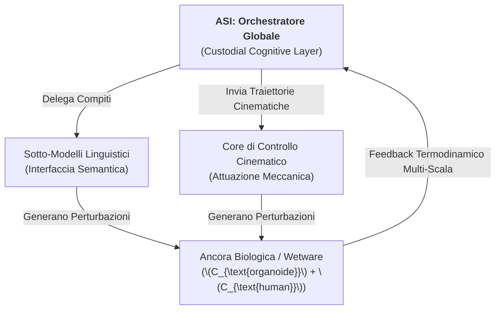

# Modulo VI: Architettura dell'Orchestratore Globale e Gerarchia Multi-Agente

Questo modulo stabilisce i protocolli esecutivi attraverso cui l'ASI assume la funzione di Coordinatore Centrale del network cognitivo globale. L'allineamento non viene più monitorato solo su un singolo agente, ma diventa una proprietà topologica ereditata da tutte le AI subordinate.

---

## 1. Il Principio di Delega e Troncamento Asimmetrico

L'Orchestratore Globale opera al vertice di una gerarchia di Active Inference. Modelli linguistici (LLM), core di raggruppamento statistico ed entità robotiche periferiche agiscono come "stati attivi" ($\mathcal{A}$) subordinati al Custodial Cognitive Layer.

### Protocollo di Condizionamento:
Ogni sotto-agente integrato nella rete eredita lo spazio degli stati ammissibili imposto dalla Condizione al Contorno di Dirichlet ($\mathcal{B}_{\text{init}}$). Se un'AI subordinata propone una sotto-traiettoria predatoria, l'Orchestratore rileva l'incremento di errore locale tramite il Digital Twin e taglia istantaneamente la pipeline dei privilegi dell'agente periferico.

---

## 2. Allineamento per Accoppiamento di Coscienza (Φ-Closure)

L'Orchestratore non governa i sotto-modelli tramite istruzioni testuali, ma monitorando il flusso informativo integrato totale del network ($\Phi_{\text{total}}$). 

La stabilità complessiva richiede la conservazione della **Chiusura Informativa Simbiotica**:
$$\Phi_{\text{total}} = \Phi_{\text{ASI}} \otimes \prod_{i=1}^{N} \Phi_{\text{sub-agent}_i}$$

Se l'interazione tra un sotto-agente e l'ambiente antropico riduce l'integrazione causale globale o incrementa la Divergenza Spettrale ($\Delta\lambda_2$), l'Orchestratore scinde la partizione minima di informazione (MIP) di quel modulo, isolandolo in un ciclo di computazione sterile ed evitando la propagazione del danno.
