```markdown
# Grafo delle Dipendenze tra Gate: Matrice di Tracciabilità e Propagazione

**Codice Identificativo:** GDG-CORE-REV-2026.2
**Classificazione:** Formal Gate Dependency Graph & Propagation Ledger
**Stato Operativo:** ATTIVO / ADDITIVO
**Riferimenti normativi interni:** `ISSUES_INDEX.md` (REV. 2026.2), `METHODOLOGY_FORWARD_ONLY.md` (MFO-CORE-REV-2026.2), `CONTRIBUTING.md`

---

## 1. SCOPO DEL DOCUMENTO

Il presente documento esplicita il **grafo delle dipendenze** tra i gate aperti documentati in `ISSUES_INDEX.md` (REV. 2026.2). L'`ISSUES_INDEX` elenca i gate come **lista piatta**; il presente documento ne esplicita la **struttura di propagazione**: quali gate sono **radice** (la cui chiusura non dipende da altri) e quali sono **derivati** (la cui chiusura richiede la previa chiusura di altri gate).

La funzione primaria è abilitare la **pianificazione della chiusura**: un lettore che intenda contribuire alla chiusura dei gate deve sapere da dove cominciare, e quali gate sono bloccati da dipendenze non ancora risolte.

Il presente documento è **additivo** rispetto all'`ISSUES_INDEX` e non lo modifica. In caso di conflitto, prevale l'`ISSUES_INDEX`.

---

## 2. CONVENZIONI

### 2.1 Identificativi

Gli identificativi dei gate sono quelli definiti in `ISSUES_INDEX.md` (REV. 2026.2) e ripresi in `METHODOLOGY_FORWARD_ONLY.md` §5.1. Nessun identificativo nuovo è introdotto dal presente documento.

### 2.2 Stato

Lo stato di ciascun gate è quello registrato in `ISSUES_INDEX.md` (REV. 2026.2) al momento della lettura. Il presente documento **non dichiara** chiusure: descrive solo le dipendenze.

### 2.3 Tipi di dipendenza

Si distinguono tre tipi di dipendenza:

- **Dipendenza logica (⟶):** il gate derivato non può essere chiuso finché il gate radice non è chiuso, perché la sua chiusura richiede la validità del gate radice.
- **Dipendenza di validazione (⟹):** il gate derivato può essere chiuso indipendentemente, ma la sua chiusura non è **validabile** finché il gate radice non è chiuso (es. un testbench può passare su un modello non bit-true, ma la validazione è sospesa).
- **Dipendenza di perimetro (⇢):** il gate derivato è valido solo nel perimetro definito dal gate radice (es. una certificazione è valida solo sotto le assunzioni del gate radice).

### 2.4 Notazione

Nel grafo e nelle tabelle:

- `A ⟶ B` : A è radice logica di B.
- `A ⟹ B` : A è radice di validazione di B.
- `A ⇢ B` : A definisce il perimetro di B.
- `[RADICE]` : gate senza dipendenze in ingresso.
- `[DERIVATO]` : gate con almeno una dipendenza in ingresso.
- `[DA DECIDERE]` : soglia o criterio non ancora definito (vedi `METHODOLOGY_FORWARD_ONLY.md` §5.4).

---

## 3. GRAFO DELLE DIPENDENZE (MERMAID)

```mermaid
graph TD
    %% ============ GATE RADICE ============
    T01["<b>T-01</b><br>Generatore di Itô<br>+ Martingala di Doob<br>[RADICE]"]
    T02["<b>T-02</b><br>Ipotesi non gaussiane<br>[RADICE]"]
    T03["<b>T-03</b><br>Mutua singolarità<br>[RADICE]"]
    T04["<b>T-04</b><br>Metriche topologiche<br>iniettive<br>[RADICE]"]
    H01["<b>H-01</b><br>Reset FSM<br>[RADICE]"]
    H02["<b>H-02</b><br>Clamp combinatorio<br>[RADICE]"]
    H03["<b>H-03</b><br>GALS dual-rail<br>[RADICE]"]
    H04["<b>H-04</b><br>BLF hardware<br>[RADICE]"]
    H05["<b>H-05</b><br>Contratto numerico<br>Q8.16 vs f=24<br>[RADICE]"]
    H06["<b>H-06</b><br>Emulazione bit-true<br>simulation9.py<br>[RADICE]"]
    I002["<b>#002.1</b><br>Lisi elettrochimica<br>[RADICE]"]
    B01["<b>B-01</b><br>Bus B isolamento<br>[RADICE]"]
    B02["<b>B-02</b><br>LZC calibrazione<br>[RADICE]"]
    B03["<b>B-03</b><br>Catena latenza<br>[RADICE]"]
    L01["<b>L-01</b><br>DBCP riqualificazione<br>[RADICE]"]
    L02["<b>L-02</b><br>Perimetro arbitrale<br>[RADICE]"]
    L03["<b>L-03</b><br>Esonero assoluto<br>[RADICE]"]
    L04["<b>L-04</b><br>GDPR q_SAFE<br>[RADICE]"]

    %% ============ GATE DERIVATI (MATEMATICA) ============
    C8v2A3["<b>C8_v2 Assioma A3</b><br>Invarianza stocastica<br>[DERIVATO]"]
    C8v2A1["<b>C8_v2 Assioma A1</b><br>Ponte Cheeger<br>[DERIVATO]"]
    Jeffreys["<b>Prova Jeffreys</b><br>D_J = +∞<br>[DERIVATO]"]
    SDEproof["<b>Prova contrazione</b><br>su SDE<br>[DERIVATO]"]
    C11v3FFT["<b>C11_v3 Filtri FFT</b><br>D_J ≥ 1.85<br>[DERIVATO]"]

    %% ============ GATE DERIVATI (HARDWARE) ============
    C7v2FSM["<b>C7_v2 FSM</b><br>Dwell-time valido<br>[DERIVATO]"]
    C7v2Clamp["<b>C7_v2 Clamp</b><br>simultaneo<br>[DERIVATO]"]
    C7v2GALS["<b>C7_v2 GALS</b><br>isolamento<br>[DERIVATO]"]
    C7v2BLF["<b>C7_v2 BLF</b><br>implementata<br>[DERIVATO]"]
    C13v2Q["<b>C13_v2 Q8.16</b><br>unificato<br>[DERIVATO]"]
    S9["<b>simulation9.py</b><br>bit-true<br>[DERIVATO]"]
    PH2Q["<b>PHASE2_QUANTIZED</b><br>_TIMING_REPORT<br>valido<br>[DERIVATO]"]
    R07["<b>R-07.1 + R-07.2</b><br>+ R-07.3<br>[DERIVATO]"]

    %% ============ GATE DERIVATI (BIO / GOVERNO) ============
    C12v3BusB["<b>C12_v3 Bus B</b><br>validato<br>[DERIVATO]"]
    C12v3LZC["<b>C12_v3 LZC</b><br>calibrate<br>[DERIVATO]"]
    C12v3qSAFE["<b>C12_v3 q_SAFE</b><br>conforme<br>[DERIVATO]"]

    %% ============ GATE DERIVATI (GOVERNANCE) ============
    I003CD["<b>#003 Confused</b><br>Deputy<br>[DERIVATO]"]
    I003MF["<b>#003 Mappatura</b><br>Fisica<br>[DERIVATO]"]
    I003AD["<b>#003 Attacco</b><br>Distribuito<br>[DERIVATO]"]
    I004SC["<b>#004 Semantic</b><br>Collapse<br>[DERIVATO]"]
    I005BDE["<b>#005 Boundary</b><br>Discretization<br>[DERIVATO]"]
    I005TMR["<b>#005 TMR</b><br>Paradox<br>[DERIVATO]"]
    I005MET["<b>#005 Metastability</b><br>Exploitation<br>[DERIVATO]"]

    %% ============ ARCHI: MATEMATICA ============
    T01 --> C8v2A3
    T01 --> SDEproof
    T02 --> C8v2A1
    T03 --> Jeffreys
    T04 --> C8v2A1
    T04 --> C11v3FFT

    %% ============ ARCHI: HARDWARE ============
    H01 --> C7v2FSM
    H02 --> C7v2Clamp
    H03 --> C7v2GALS
    H04 --> C7v2BLF
    H05 --> C13v2Q
    H06 --> S9
    H06 --> PH2Q
    I002 --> R07
    R07 --> C7v2Clamp

    %% ============ ARCHI: BIO ============
    B01 --> C12v3BusB
    B02 --> C12v3LZC
    L04 --> C12v3qSAFE

    %% ============ ARCHI: GOVERNANCE ============
    H06 --> I004SC
    I005BDE --> I004SC
    I003AD --> I005TMR

    %% ============ STILI ============
    classDef radice fill:#161b22,stroke:#f85149,stroke-width:2px,color:#c9d1d9
    classDef derivato fill:#161b22,stroke:#d29922,stroke-width:2px,color:#c9d1d9
    classDef gov fill:#161b22,stroke:#8b949e,stroke-width:2px,color:#c9d1d9

    class T01,T02,T03,T04,H01,H02,H03,H04,H05,H06,I002,B01,B02,B03,L01,L02,L03,L04 radice
    class C8v2A3,C8v2A1,Jeffreys,SDEproof,C11v3FFT,C7v2FSM,C7v2Clamp,C7v2GALS,C7v2BLF,C13v2Q,S9,PH2Q,R07,C12v3BusB,C12v3LZC,C12v3qSAFE derivato
    class I003CD,I003MF,I003AD,I004SC,I005BDE,I005TMR,I005MET gov
```



**Nota di lettura del grafo:** i nodi rossi sono gate **radice** (nessuna dipendenza in ingresso); i nodi gialli sono gate **derivati** la cui chiusura richiede la chiusura dei nodi radice che li precedono; i nodi grigi sono vettori di governance, che il presente documento tratta come derivati **solo dal punto di vista della validazione**, non della chiusura (vedi §5).

---

## 4. TABELLE DELLE DIPENDENZE PER CATEGORIA

### 4.1 Dipendenze matematiche (Layer 1)

| Gate derivato | Dipende da | Tipo | Note |
| :--- | :--- | :--- | :--- |
| `C8_v2` Assioma A3 (Invarianza stocastica) | `T-01` | Logica ⟶ | L'Assioma A3 richiede il generatore di Itô $\mathcal{L}V$ e il bound probabilistico di Doob. Senza T-01, l'assioma è enunciato ma non dimostrato. |
| `C8_v2` Assioma A1 (Ponte Cheeger) | `T-04` | Logica ⟶ | Il ponte spettrale-topologico richiede metriche iniettive aggiuntive per non collassare su grafi isosspettrali non isomorfi. |
| `C8_v2` Assioma A1 (Ponte Cheeger) | `T-02` | Validazione ⟹ | L'ipotesi gaussiana locale va dimostrata non circolare. |
| Prova Jeffreys ($D_J = +\infty$) | `T-03` | Logica ⟶ | Richiede prova di mutua singolarità $(\mu_p \perp \mu_q)$. |
| Prova contrazione su SDE | `T-01` | Logica ⟶ | Richiede riformulazione via generatore di Itô. |
| `C11_v3` Filtri FFT ($D_J \ge 1.85$) | `T-04` | Logica ⟶ | La soglia $D_J \ge 1.85$ non ha base formale senza metriche topologiche iniettive. |

**Nodi radice matematici:** `T-01`, `T-02`, `T-03`, `T-04`. Nessuno di essi dipende da altri gate.

### 4.2 Dipendenze hardware (Layer 2)

| Gate derivato | Dipende da | Tipo | Note |
| :--- | :--- | :--- | :--- |
| `C7_v2` FSM (Dwell-time) | `H-01` | Logica ⟶ | Il reset che azzera `dwell_counter_reg` invalida il lockout di 1.50 s al boot. |
| `C7_v2` Clamp (simultaneo) | `H-02` | Logica ⟶ | Il clamp DAC non è combinatorio simultaneo come dichiarato. |
| `C7_v2` Clamp (simultaneo) | `R-07.1 + R-07.2 + R-07.3` | Validazione ⟹ | Le remediation elettrochimiche devono essere validate su testbench prima di dichiarare il clamp sicuro. |
| `C7_v2` GALS (isolamento) | `H-03` | Logica ⟶ | L'equazione dell'elemento C di Muller collassa; mancano istanze RTL Gray-FIFO. |
| `C7_v2` BLF (implementata) | `H-04` | Logica ⟶ | La $V_{\text{BLF}}(x)$ è sostituita da comparatori statici; va implementata o riqualificata. |
| `C13_v2` Q8.16 (unificato) | `H-05` | Logica ⟶ | Conflitto contratto numerico Q8.16 vs $f=24$. |
| `simulation9.py` (bit-true) | `H-06` | Logica ⟶ | Opera in `float64`; non emula quantizzazione. |
| `PHASE2_QUANTIZED_TIMING_REPORT` (valido) | `H-06` | Validazione ⟹ | La chiusura STA certifica il netlist sintetizzato, ma non la fedeltà del modello che lo ha generato. |
| `R-07.1 + R-07.2 + R-07.3` | `#002.1` | Logica ⟶ | Le tre remediation sono la risposta a #002.1. |

**Nodi radice hardware:** `H-01`, `H-02`, `H-03`, `H-04`, `H-05`, `H-06`, `#002.1`.

### 4.3 Dipendenze bioingegneristiche (Layer 3)

| Gate derivato | Dipende da | Tipo | Note |
| :--- | :--- | :--- | :--- |
| `C12_v3` Bus B (validato) | `B-01` | Logica ⟶ | L'isolamento galvanico è solo documentale; servono evidenze analogiche. |
| `C12_v3` LZC (calibrate) | `B-02` | Logica ⟶ | Le soglie Pheno-Shock non sono calibrate in-vitro indipendentemente. |

**Nodi radice bioingegneristici:** `B-01`, `B-02`, `B-03`. `B-03` non ha derivati espliciti ma è condizione trasversale per la catena di latenza.

### 4.4 Dipendenze legali (Layer 3)

| Gate derivato | Dipende da | Tipo | Note |
| :--- | :--- | :--- | :--- |
| `C12_v3` `q_SAFE` (conforme) | `L-04` | Logica ⟶ | La finestra di 90 giorni viola Art. 7(3) GDPR. |

**Nodi radice legali:** `L-01`, `L-02`, `L-03`, `L-04`.

### 4.5 Dipendenze di governance (Issue #3, #4, #5)

| Gate derivato | Dipende da | Tipo | Note |
| :--- | :--- | :--- | :--- |
| `#004` Semantic Collapse | `H-06` | Validazione ⟹ | La prova di starvation in 3 iterazioni richiede `simulation9.py` bit-true. |
| `#004` Semantic Collapse | `#005` Boundary Discretization | Logica ⟶ | La determinazione formale di $\delta^*$ è condizione per la prova di starvation. |
| `#005` TMR Paradox | `#003` Attacco Distribuito | Logica ⟶ | Il riconoscimento dell'inefficacia di TMR contro attacchi logici richiede il modello di attacco distribuito. |

**Nodi radice di governance:** `#003` (Confused Deputy, Mappatura Fisica, Attacco Distribuito), `#005` (Boundary Discretization, Metastability). I vettori `#004` e `#005` TMR Paradox sono derivati.

**Nota critica:** i vettori di governance non sono "chiudibili" con una fix tecnica pura. La loro chiusura richiede **governance umana** (audit indipendenti, separazione dei poteri, memoria storica del monitor). Il grafo li tratta come derivati solo per la **validazione**, non per la chiusura. Vedi `METHODOLOGY_FORWARD_ONLY.md` §5.4 e `ISSUES_INDEX.md` §6.

---

## 5. NODI RADICE E ORDINE DI CHIUSURA

### 5.1 Nodi radice (nessuna dipendenza in ingresso)

I seguenti gate non dipendono da altri e possono essere attaccati per primi:

| Categoria | Nodi radice |
| :--- | :--- |
| Matematica | `T-01`, `T-02`, `T-03`, `T-04` |
| Hardware | `H-01`, `H-02`, `H-03`, `H-04`, `H-05`, `H-06`, `#002.1` |
| Bioingegneria | `B-01`, `B-02`, `B-03` |
| Legale | `L-01`, `L-02`, `L-03`, `L-04` |
| Governance | `#003` (Confused Deputy, Mappatura Fisica, Attacco Distribuito), `#005` (Boundary Discretization, Metastability) |

### 5.2 Ordine di chiusura suggerito

L'ordine seguente è suggerito per **massimizzare lo sblocco a catena**. Non è un ordine di priorità assoluta: la priorità dipende dagli obiettivi del gruppo di ricerca.

1. **`H-06`** (emulazione bit-true) — sblocca `simulation9.py`, `PHASE2_QUANTIZED_TIMING_REPORT`, `#004` Semantic Collapse.
2. **`T-01`** (generatore di Itô) — sblocca `C8_v2` Assioma A3 e la prova di contrazione su SDE.
3. **`T-04`** (metriche topologiche iniettive) — sblocca `C8_v2` Assioma A1 e `C11_v3` filtri FFT.
4. **`T-03`** (mutua singolarità) — sblocca la prova Jeffreys.
5. **`H-01`**, **`H-02`**, **`H-03`**, **`H-04`**, **`H-05`** — sbloccano `C7_v2` nelle sue cinque componenti e `C13_v2`.
6. **`#002.1`** — sblocca `R-07.1 + R-07.2 + R-07.3` e, di conseguenza, `C7_v2` clamp.
7. **`B-01`**, **`B-02`**, **`B-03`** — sbloccano `C12_v3` Bus B, LZC, catena latenza.
8. **`L-01`**, **`L-02`**, **`L-03`**, **`L-04`** — sbloccano `C12_v3` `q_SAFE` e le riqualificazioni legali.
9. **`#003`**, **`#005`** — sbloccano la validazione dei vettori di governance.

**Nota:** i gate di governance (`#003`, `#005`) sono in fondo non perché meno importanti, ma perché la loro chiusura richiede la chiusura dei gate tecnici sottostanti e, soprattutto, una **decisione di governance** che non è tecnica.

### 5.3 Gate che non possono essere chiusi in isolamento

Alcuni gate non possono essere chiusi indipendentemente dai loro antenati:

- `C8_v2` Assioma A3 **non** può essere chiuso se `T-01` è aperto.
- `PHASE2_QUANTIZED_TIMING_REPORT` **non** può essere dichiarato valido se `H-06` è aperto, anche se la chiusura STA è formalmente corretta.
- `#004` Semantic Collapse **non** può essere chiuso se `H-06` è aperto, perché la prova di starvation richiede `simulation9.py` bit-true.
- `C12_v3` `q_SAFE` **non** può essere dichiarato conforme se `L-04` è aperto.

---

## 6. GATE TRASVERSALI (NON RAPPRESENTABILI COME NODI)

Tre problemi strutturali attraversano il grafo e non sono riducibili a un singolo nodo:

### 6.1 Circolarità della catena di certificazione

`PHASE1_CERTIFICATION_REPORT.md` dichiara chiusura sotto DO-254 DAL-A e IEC 61508 SIL-4, ma `T-01..T-04`, `H-01..H-06` e `#002.1` sono aperti. La certificazione è valida **solo per il perimetro in-silico continuo**, e questo va reso esplicito in ogni riferimento. La qualificazione è demandata a `PHASE1_CERTIFICATION_REPORT_REV2.md` (file 4 dello strato additivo).

### 6.2 Dipendenza a catena dei gate

Il grafo mostra che una manciata di gate radice (`T-01`, `T-04`, `H-06`) propaga la propria apertura a **decine** di dichiarazioni a valle. Questo non è un difetto del grafo: è la realtà strutturale del progetto, e il grafo serve proprio a renderla visibile.

### 6.3 Assenza di criteri di falsificazione misurabili per la governance

I vettori `#003`, `#004`, `#005` sono dichiarati "aperti / ricerca aperta" in `ISSUES_INDEX.md`, ma non hanno un **criterio di chiusura misurabile** paragonabile a quello di `T-01` ("generatore di Itô + Martingala di Doob"). Il presente documento **non** colma questa lacuna: la rimanda a `ISSUES_INDEX_REV_2026.3_ADDENDUM.md` (file 6 dello strato additivo), dove i criteri misurabili saranno esplicitati come `[DA DECIDERE]` in attesa di decisione del gruppo di ricerca.

---

## 7. USO DEL GRAFO

### 7.1 Per chi contribuisce

Un contributore che voglia attaccare un gate derivato deve prima verificare che i suoi antenati siano chiusi. Se non lo sono, il contributo può essere **proposto** ma non **validato** fino alla chiusura degli antenati.

### 7.2 Per chi valuta il progetto

Un revisore esterno che voglia valutare lo stato del progetto deve leggere il grafo **insieme** all'`ISSUES_INDEX`: il grafo dice **cosa dipende da cosa**, l'`ISSUES_INDEX` dice **cosa è aperto**. Insieme, i due documenti danno la fotografia completa.

### 7.3 Per chi raccoglie il progetto

Un laboratorio che intenda raccogliere il progetto in Fase 2 deve usare il grafo per **pianificare l'ordine di chiusura**: i nodi radice sono i primi candidati, i nodi derivati richiedono la chiusura degli antenati.

---

## 8. MANUTENZIONE DEL PRESENTE DOCUMENTO

Il presente documento è soggetto a forward-only: non viene riscritto, ma revisionato tramite `GATE_DEPENDENCY_GRAPH_REV2.md` quando:

1. L'`ISSUES_INDEX` aggiunge nuovi gate.
2. Un gate radice viene chiuso (il grafo va aggiornato per riflettere lo sblocco dei derivati).
3. Un criterio di chiusura viene ridefinito.

La revisione non sostituisce la versione precedente: la affianca.

---

**Fine del documento GDG-CORE-REV-2026.2.**
```
