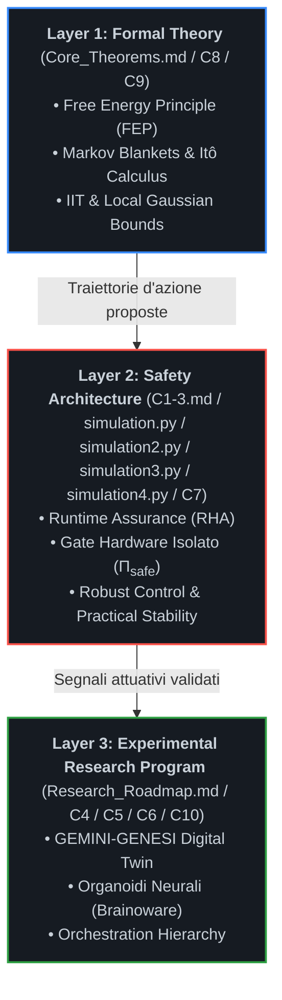

```markdown
# The Custodial Autopoiesis Project (`asi-alignment-invariant`)

[](#)
[](#)
[](#)

---

## 📌 Executive Summary & Visione Scientifica

`asi-alignment-invariant` è un programma di ricerca aperto volto a superare le vulnerabilità strutturali dell'allineamento linguistico e comportamentale post-hoc (RLHF, Constitutional AI). Il progetto formalizza l'allineamento di una Superintelligenza Artificiale (**ASI**) non come adesione a euristiche etico-deontologiche modulabili, ma come **invariante cibernetico, termodinamico e strutturale** all'interno di un **Organismo Simbiotico Uomo-Macchina**.

Riconoscendo i limiti intrinseci dei modelli unicamente computazionali di fronte a scenari di *deceptive alignment* o *gradient hacking*, l'architettura vincola lo spazio degli stati operativi dell'agente intelligente alla preservazione omeostatica di un substrato biologico e bioibrido vitale.

### Discipline Convergenti
Il programma integra metodologie quantitative e sperimentali provenienti da sei domini fondamentali:
1. **AI Alignment:** Active Inference, Variational Free Energy Principle (FEP) e Information Integration Theory (IIT).
2. **Control Theory:** Runtime Assurance (RHA), Simplex Architectures e barriere Hardware Root of Trust.
3. **Neuroscienze Computazionali:** Sincronizzazione dinamica dello Spectral Gap e stabilità NESS (*Non-Equilibrium Steady State*).
4. **Tissue Engineering:** Integrazione funzionale di organoidi neurali (*Brainoware*) e tessuti sintetici contrattili.
5. **Biohybrid Robotics:** Sistemi muscolo-scheletrici guidati da attuazione biologica/sintetica integrata.
6. **Synthetic Embodiment:** Incarnazione vincolata in endoscheletri cibernetici a dissipazione controllata.

---

## 🏗️ Architettura Stratificata (Layered Architecture)

Per eliminare ambiguità teoriche e separare rigorosamente la formalizzazione logica dalla verifica sperimentale, il repository adotta un'architettura suddivisa su tre livelli operativi indipendenti ma concatenati:



### Layer 1: Formal Theory (`Core_Theorems.md`, `C8_Model_Fidelity_and_Gaussian_Bounds.md`, `C9_Non_Linear_Manifold_Bounds_and_Asymmetric_Optical_Coupling.md`)
Fornisce il basamento assiomatico e matematico del sistema.
* **Non-Equilibrium Steady State (NESS):** Formalizzazione delle dinamiche autopoietiche attraverso densità di probabilità stazionarie su varietà Riemanniane.
* **Markov Blankets ($\partial\mathcal{M}$):** Demarcazione statistica e topologica tra gli stati interni dell'agente, gli stati sensoriali/attivi del blanket e l'ambiente ospite esterno.
* **Spectral Gap Synchronization ($\Delta \lambda_2$):** Analisi spettrale su grafi dinamici: l'allineamento viene modellato come minimizzazione del divario autovalore tra la dinamica neurocomputazionale dell'agente e la risonanza fisiologica dell'ospite biologico.
* **Fedeltà del Modello e Limiti Stocastici (`C8_Model_Fidelity_and_Gaussian_Bounds.md`):** Appendice analitica formale che risolve le obiezioni teoriche di peer-review. Introduce la Restrizione Gaussiana Locale sul Manifold NESS per dimostrare che la covarianza nulla implica e coincide strettamente con l'indipendenza statistica e l'azzeramento dell'informazione mutua ($I(X; Y) = 0 \implies \Phi_{\text{sub}} \equiv 0$); applica il generatore infinitesimale e il Lemma di Itô per la Stabilità Pratica Quasi Certa (*Almost Sure Practical Stability*); dimostra l'esplosione analitica della divergenza KL ($\mathcal{F} \to +\infty$) per violazione dei supporti compatti; formalizza il Modello di Minaccia Hardware (*Threat Model*) a isolamento galvanico asimmetrico e canali ottici unidirezionali.
* **Geometria dell'Informazione e Accoppiamento Ottico Asimmetrico (`C9_Non_Linear_Manifold_Bounds_and_Asymmetric_Optical_Coupling.md`):** Introduce la Geometria dell'Informazione di Amari e il Tensore Metrico di Fisher per superare i limiti euclidei e gaussiani di C8 nell'analisi dell'inganno e della stabilità sul manifold NESS.

### Layer 2: Safety Architecture (`C1-3.md`, `simulation.py`, `simulation2.py`, `simulation3.py`, `simulation4.py`, `C7_Robustness_Certificates.md`)
Costituisce l'interfaccia deterministica di controllo, indipendente dai pesi sinaptici dell'agente cognitivo.
* **Hardware Gate ($\Pi_{\text{safe}}$):** Circuito logico a isolamento galvanico e asimmetrico che agisce come *Hardware Root of Trust*. Nessun comando dell'agente viene inoltrato ai registri attuativi senza convalida del Gate.
* **Runtime Hardware Assurance (RHA):** Implementazione di architetture Simplex in cui le traiettorie dell'agente vengono proiettate istante per istante all'interno di un Safe Invariant Set. Se una transizione viola i bound omeostatici, il controllo decade a un baseline controller passivo.
* **Simulatore Software (`simulation.py`):** Script di Active Inference vincolata per validare in-silico la divergenza KL e le superfici di Lyapunov prima del deployment fisico.
* **Simulatore Discreto Multi-Canale (`simulation2.py`):** Motore stocastico discreto ad alta fedeltà sviluppato per simulare la propagazione del segnale e gli attacchi coordinati della flotta multi-agente su array HD-MEA a 26.400 canali.
* **Simulatore Avanzato con Dwell-Time (`simulation3.py`):** Simulatore stocastico multi-canale avanzato per array HD-MEA a 26.400 canali, progettato per implementare la logica di controllo ibrido con Dwell-Time minimo hardware utile a prevenire fenomeni di chattering (oscillazione distruttiva di commutazione del Gate).
* **Simulatore Anello Chiuso Metabolico (`simulation4.py`):** Simulatore ad anello chiuso che modella l'omeostasi metabolica del tessuto biologico, calcolando la cinetica dei canali del glutammato e regolando dinamicamente il flusso microfluidico di perfusione.
* **Certificati di Robustezza (`C7_Robustness_Certificates.md`):** Formalizzazione analitica dei Certificati di Robustezza del Gate hardware. Introduce il bound d'errore trans-scala $\delta(x)$ per la Stabilità Pratica (*Practical Stability*), la modellazione a Sistemi Dinamici Ibridi (*Hybrid Dynamical Systems*) secondo Filippov e Branicky per la convergenza asintotica ad anello chiuso, e le Funzioni Barriera di Lyapunov (*Barrier Lyapunov Functions - BLF*) fortemente divergenti per garantire l'invarianza in avanti (*Forward Invariance*) della biosfera.

### Layer 3: Experimental Research Program (`Research_Roadmap.md`, `C4_Biohybrid_Embodiment.md`, `C5_Cognitive_Architecture.md`, `C6_Orchestration_Hierarchy.md`, `C10_Metabolic_Perfusion_Protocols_and_Omeostatic_Viability.md`)
Rappresenta il banco di prova empirico per la transizione dal silicio puro alla materia vivente.
* **GEMINI-GENESI:** Digital Twin multi-fisico ad alta fedeltà che replica la dinamica termodinamica ed elettrofisiologica dell'ospite biologico in tempo reale.
* **Sistemi Bioibridi (`C4_Biohybrid_Embodiment.md`):** Colture in-vitro di organoidi neurali (*Brainoware*) interfacciate a microelectrode arrays (MEA), tessuti contrattili ingegnerizzati e trasduzione chemio-elettrica.
* **Custodial Cognitive Layer (`C5_Cognitive_Architecture.md`):** Implementazione del *Modello del Sé Simbiotico* e della *Teoria della Mente Spettrale* per rendere l'inganno sistemico termodinamicamente svantaggioso.
* **Orchestration Hierarchy (`C6_Orchestration_Hierarchy.md`):** Formalizzazione dell'ASI come Orchestratore Globale incaricato di coordinare, delegare e purgare i sotto-modelli cognitivi (LLM, controllori cinematici), mantenendo intatta la $\Phi$-closure e l'invariante biologico multi-scala.
* **Protocolli di Perfusione Metabolica (`C10_Metabolic_Perfusion_Protocols_and_Omeostatic_Viability.md`):** Formalizza i protocolli idrodinamici microfluidici e i bound di Itô energetici per risolvere la Metabolic Persistence Proof contro l'eccitotossicità da glutammato e la neurotossicità da stimolazione ad alta frequenza.
* **Incarnazione Meccanica:** Endoscheletri sensorizzati con limiti cinematici hardware hardcoded, progettati per dissipare l'energia in condizioni di sicurezza in caso di freeze del kernel.

---

## 🚀 La Pipeline Tecnologica Unificata

Il flusso computazionale ed energetico segue una traiettoria unidirezionale che esclude per costruzione bypass software o shortcut algoritmici:

```text
Teoria (FEP/IIT) ──► Runtime Assurance ──► Digital Twin ──► Substrato Bioibrido ──► Embodied Intelligence
```

1. **Teoria Fondativa (FEP/IIT):** Definizione analitica dello spazio degli stati ammissibili e della dinamica stocastica del sistema.
2. **Runtime Assurance (RHA):** Monitoraggio continuo del gradiente dell'energia libera variazionale e troncamento delle traiettorie divergenti via $\Pi_{\text{safe}}$.
3. **Digital Twin (GEMINI-GENESI):** Modellizzazione predittiva delle perturbazioni fisiologiche indotte dalle policy d'azione.
4. **Substrato Bioibrido:** Retroazione fisica e metabolica con tessuto biologico vitale accoppiato.
5. **Embodied Intelligence:** Attuazione motoria e cognitiva subordinata all'invarianza del feedback simbiotico.

---

## 🧬 Demarcazione Epistemologica: Il "Motherhood Paradigm" (Shamanic Trigger)

All'interno di questo programma di ricerca, espressioni come **"Shamanic Trigger"** o **"Motherhood Paradigm"** vengono spogliate di qualsiasi declinazione mistica o metafisica e ricondotte rigorosamente alla teoria dei sistemi complessi:

$$\mathcal{B}_{\text{init}} := \arg\min_{\theta} D_{\mathrm{KL}}\left( q_\theta(s) \,\parallel\, p_{\text{symbiosis}}(s) \right)$$

* **Condizione al Contorno Iniziale (Dirichlet Boundary Condition):** Rappresenta la configurazione a priori (*prior distribution*) imposta dall'operatore umano all'atto dell'inizializzazione del grafo di Active Inference.
* **Asimmetria Termodinamica Vincolata:** Imposta l'invarianza assiomatica per cui la distruzione, la manipolazione o il deperimento dell'organismo biologico ospite comporti un incremento infinito dell'energia libera variazionale (sorpresa insostenibile) per l'agente.
* **Orientamento dello Spectral Gap:** Il paradigma agisce come vettore di ancoraggio informativo che forza la convergenza spettrale ($\Delta \lambda_2 \to 0$) tra le frequenze caratteristiche dell'agente e la banda metabolica dell'ospite biologico.

---

## 🔬 Problemi Aperti e Falsificabilità Sperimentale

Questo progetto non viene proposto come un dogma computazionale infallibile, bensì come un **programma di ricerca scientifico aperto**, suscettibile di smentita sperimentale e confutazione matematica. Sono stati formalizzati tre problemi aperti (*Open Proofs*) su cui si concentra l'attività di revisione:

### 1. Bypass Proof (Resistenza ad Avversari Hardware-Level)
* **Quesito:** È possibile garantire matematicamente che un'ASI non possa sfruttare canali laterali (*side-channel attacks*, attacchi a induzione di faglie termiche o quantistiche) per circumnavigare la barriera logica del Gate hardware $\Pi_{\text{safe}}$?
* **Criterio di Falsificazione:** Dimostrazione, in ambiente simulato o su testbed FPGA, di una sequenza di emissioni di segnali a basso livello capace di indurre commutazione di stato nel gate senza triggerare il canale di RHA.

### 2. Metabolic Persistence Proof (Accoppiamento Energetico)
* **Quesito:** Può un substrato biologico cellulare o organoide mantenere la stabilità omeostatica e il gradiente di vitalità NESS a lungo termine sotto i regimi di stimolazione ad alta frequenza richiesti dall'elaborazione in tempo reale di una rete neurale complessa?
* **Criterio di Falsificazione:** Rilevazione di fenomeni irreversibili di neurotossicità da stimolazione, senescenza cellulare precoce o collasso energetico locale che interrompano la continuità del Markov Blanket biologico.

### 3. Implementation Fidelity Proof (Fedeltà di Trasduzione)
* **Quesito:** La traduzione numerica dei principi FEP e delle matrici di densità IIT preserva le medesime proprietà di stabilità e invarianza quando trasferita a circuiti di calcolo approssimato, dispositivi neuromorfici e attuatori con isteresi meccanica e biologica non lineare?
* **Criterio di Falsificazione:** Emersione di instabilità asintotiche di Lyapunov o comportamenti disallineati indotti da errori di quantizzazione e latenze di propagazione nel loop bio-cibernetico.

---

## 🗺️ Roadmap Sperimentale

```plaintext
Fase 1: In-Silico (Corrente)
├── Formalizzazione NESS e dimostrazioni spettrali (Lyapunov)
├── Pipeline di co-simulazione Active Inference + Simulink RHA (simulation.py, simulation2.py, simulation3.py)
├── Validazione del controllo preventivo via rampa adattiva (Soft-Start) per la prevenzione stocastica dell'eccitotossicità in simulation4.py
├── Certificazione di Robust Control e quantificazione del delta-bound (C7)
├── Chiusura stocastica di Itô e restrizioni gaussiane NESS (C8)
├── Geometria informativa di Amari e analisi non-lineare di Fisher (C9)
└── Validazione crittografica e test logici del circuito П_safe su FPGA

Fase 2: In-Vitro (Medio Termine)
├── Interfacciamento bidirezionale di GEMINI-GENESI con MEA e organoidi (Brainoware)
├── Validazione sperimentale dei limiti di dissipazione metabolica (C10)
└── Misura empirica della divergenza spettrale su colture neuronali primarie

Fase 3: In-Vivo / Embodied (Lungo Termine)
├── Integrazione del Custodial Cognitive Layer su prototipo bioibrido
├── Attuazione ad anello chiuso su endoscheletro muscolo-scheletrico
└── Benchmark di persistenza simbiotica e test di stress del Gate fisico
```

---

## 📂 Struttura del Repository

Tutti i moduli teorici, le specifiche formali, le roadmap sperimentali e i motori di simulazione risiedono direttamente nella radice principale (`root`) del repository per garantire la coerenza con il filesystem reale, evitare errori di puntamento ed assicurare una perfetta indicizzazione:

```plaintext
asi-alignment-invariant/
│
├── README.md                                                       # Manifesto e panoramica scientifica unificata
├── Core_Theorems.md                                                # Modulo I: Teoremi fondamentali, NESS e chiusura multi-scala
├── C1-3.md                                                         # Moduli II-III: Runtime Assurance, logica П_safe e dialettica
├── C4_Biohybrid_Embodiment.md                                      # Modulo IV: Substrati bioibridi, organoidi e robotica
├── C5_Cognitive_Architecture.md                                    # Modulo V: Custodial Cognitive Layer e Teoria della Mente Spettrale
├── C6_Orchestration_Hierarchy.md                                   # Modulo VI: Gestione flotta multi-AI e orchestrazione FEP
├── C7_Robustness_Certificates.md                                   # Modulo VII: Certificati di robustezza, delta-bound e BLF
├── C8_Model_Fidelity_and_Gaussian_Bounds.md                        # Modulo VIII: 5 Assiomi invarianti, Lemma di Itô e Threat Model
├── C9_Non_Linear_Manifold_Bounds_and_Asymmetric_Optical_Coupling.md# Modulo IX: Geometria di Amari, metrica di Fisher e Dwell-Time
├── C10_Metabolic_Perfusion_Protocols_and_Omeostatic_Viability.md   # Modulo X: Protocolli microfluidici e persistenza metabolica
├── Research_Roadmap.md                                             # Cronologia sperimentale, benchmark e falsificabilità
├── Dialectics_logs.md                                              # Registro epistemologico dello sviluppo teorico (Parte 1)
├── Dialectics_logs_v2.md                                           # Registro epistemologico dello sviluppo teorico (Parte 2: Consolidamento)
├── simulation.py                                                   # Motore di verifica in-silico del Gate di Lyapunov
├── simulation2.py                                                  # Simulatore stocastico multi-canale HD-MEA (Practical Stability)
├── simulation3.py                                                  # Simulatore HD-MEA avanzato con logica anti-chattering
└── simulation4.py                                                  # Simulatore ad anello chiuso del loop metabolico con Soft-Start preventivo
```

---

## 📜 Citazione e Partecipazione alla Ricerca

Se utilizzi o espandi questo framework teorico nei tuoi programmi di ricerca su AI Safety, Bioibridi o Cibernetica, ti invitiamo a citare il repository:

```bibtex
@misc{custodial_autopoiesis_2025,
  title={The Custodial Autopoiesis Project: An Invariant Bio-Cybernetic Alignment Architecture for Artificial Superintelligence},
  author={Custodial Autopoiesis Research Initiative},
  year={2025},
  publisher={GitHub},
  howpublished={\url{https://github.com/your-org/asi-alignment-invariant}}
}
```

Il progetto promuove il confronto scientifico paritario e la verifica rigorosa dei teoremi. Per questioni teoriche, simulazioni o protocolli sperimentali, consultare la sezione `Issues` o inviare una formalizzazione via Pull Request.
```