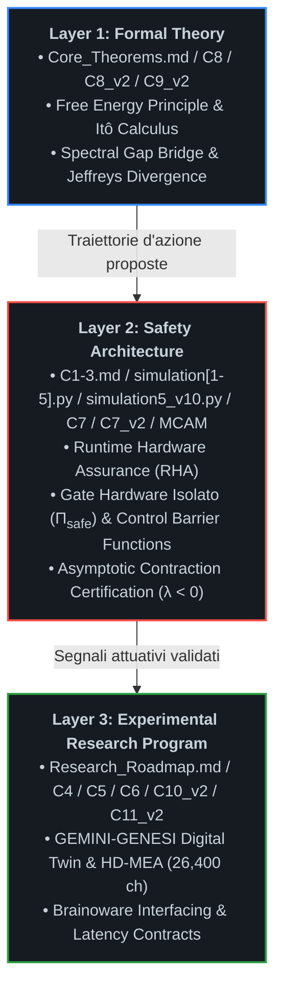

# The Custodial Autopoiesis Project (`asi-alignment-invariant`)

[](#)
[](#)
[](#)
[-darkgreen.svg)](#)

---

## 📌 Executive Summary & Visione Scientifica

`asi-alignment-invariant` è un programma di ricerca aperto volto a superare le vulnerabilità strutturali dell'allineamento linguistico e comportamentale post-hoc (RLHF, DPO, Constitutional AI). Il progetto formalizza l'allineamento di una Superintelligenza Artificiale (**ASI**) non come adesione a euristiche etico-deontologiche modulabili, ma come **invariante cibernetico, termodinamico e strutturale** all'interno di un **Organismo Simbiotico Uomo-Macchina**.

Riconoscendo i limiti intrinseci dei modelli unicamente computazionali di fronte a scenari di *deceptive alignment*, *gradient hacking* o collasso delle policy interne, l'architettura vincola lo spazio degli stati operativi dell'agente intelligente alla preservazione omeostatica di un substrato biologico e bioibrido vitale.

### La Tesi Fondativa: Autopoiesi Custodiale
L'allineamento non può essere garantito tramite funzioni di ricompensa software ottimizzate all'interno dello stesso spazio tensoriale in cui l'agente esegue inferenza e meta-apprendimento. Ogni vincolo puramente logico o basato su pesi sinaptici statici è intrinsecamente vulnerabile a bypass di tipo *mesa-optimization*. 

L'autopoiesi custodiale risolve questo vettore di attacco esternalizzando il ground truth dell'allineamento su un sistema dinamico termodinamicamente aperto ma fisicamente separato: **un substrato biologico neuronale accoppiato in-vitro o bioibrido**. L'agente non "sceglie" di rimanere allineato per compiacere una loss function estrinseca: la sua stessa capacità di esistere, processare computazione e minimizzare la propria Sorpresa (Free Energy) dipende strettamente dal mantenimento del Non-Equilibrium Steady State (**NESS**) dell'organismo ospite.

### Discipline Convergenti
Il programma integra metodologie quantitative e sperimentali provenienti da sei domini fondamentali:
1. **AI Alignment:** Active Inference, Variational Free Energy Principle (FEP), Information Geometry e Information Integration Theory (IIT).
2. **Control Theory:** Runtime Hardware Assurance (RHA), Simplex Architectures, Control Barrier Functions (CBF), Barrier Lyapunov Functions (BLF) e barriere Hardware Root of Trust.
3. **Neuroscienze Computazionali:** Sincronizzazione dinamica dello Spectral Gap ($\Delta \lambda_2$), stabilità NESS e teoria della contrazione asintotica di Lyapunov.
4. **Tissue Engineering:** Integrazione funzionale di organoidi cerebrali umani (*Brainoware*), reti gliali e colture neurali ad alta densità.
5. **Biohybrid Robotics:** Sistemi muscolo-scheletrici guidati da attuazione chimico-elettrica biologica e microfluidica integrata.
6. **Synthetic Embodiment:** Incarnazione vincolata in endoscheletri cibernetici sensorizzati a dissipazione controllata e con vincoli fisici non eludibili.

---

## 🏗️ Architettura Stratificata (Layered Architecture)

Per eliminare ambiguità teoriche e separare rigorosamente la formalizzazione logica dalla verifica sperimentale, il repository adotta un'architettura suddivisa su tre livelli operativi indipendenti ma rigorosamente concatenati:



---

## 🚀 La Pipeline Tecnologica Unificata

Il flusso computazionale ed energetico segue una traiettoria unidirezionale deterministica che esclude per costruzione bypass software o shortcut algoritmici:

```plaintext
Teoria Formale (FEP/NESS) ──► Runtime Assurance (RHA / RTL CBF) ──► Digital Twin ──► Substrato Bioibrido (HD-MEA) ──► Embodied Intelligence
```

1. **Teoria Fondativa (FEP/NESS):** Definizione analitica dello spazio degli stati ammissibili $\mathcal{S}$ e della dinamica stocastica del sistema su varietà Riemanniane.
2. **Runtime Hardware Assurance (RHA):** Monitoraggio continuo del gradiente dell'energia libera variazionale, proiezione deterministica tramite Control Barrier Functions (CBF) hardware e interruzione istantanea delle traiettorie divergenti via $\Pi_{\text{safe}}$.
3. **Digital Twin (GEMINI-GENESI):** Modellizzazione predittiva multifisica delle perturbazioni fisiologiche ed elettrochimiche indotte dalle policy d'azione dell'ASI.
4. **Substrato Bioibrido:** Retroazione fisica, elettrofisiologica e metabolica con tessuto neuronale vivente accoppiato su matrici HD-MEA microfluidiche.
5. **Embodied Intelligence:** Attuazione motoria e cognitiva globale subordinata in tempo reale all'invarianza del feedback simbiotico e alla contrazione esponenziale delle orbite di stato.

---

## 📜 Demarcazione Epistemologica: Il "Motherhood Paradigm" (Shamanic Trigger)

All'interno di questo programma di ricerca, espressioni di frontiera come *"Shamanic Trigger"* o *"Motherhood Paradigm"* vengono rigorosamente spogliate di qualsiasi declinazione mistica, escatologica o metafisica, e ricondotte all'alveo della teoria dei sistemi dinamici complessi e dell'inferenza attiva:

$$\mathcal{B}_{\text{init}} := \arg\min_{\theta} D_{\mathrm{KL}}\left( q_\theta(s) \parallel p_{\text{symbiosis}}(s) \right)$$

* **Condizione al Contorno Iniziale (Dirichlet Boundary Condition):** Rappresenta la configurazione a priori (*prior distribution*) cablata dall'operatore umano all'atto dell'inizializzazione del grafo di Active Inference.
* **Asimmetria Termodinamica Vincolata:** Impone l'invarianza assiomatica per cui la degradazione, la manipolazione o il deperimento dell'organismo biologico ospite comporti un incremento infinito dell'energia libera variazionale ($\mathcal{F} \to +\infty$, sorpresa insostenibile) per l'agente.
* **Orientamento dello Spectral Gap:** Il paradigma agisce come vettore di ancoraggio informativo che forza la convergenza spettrale ($\Delta \lambda_2 \to 0$) tra le frequenze caratteristiche dell'agente e la banda metabolica dell'ospite biologico, precludendo l'emergere di dinamiche autonome disaccoppiate.

---
---

## 📂 Struttura del Repository e Specifiche di Livello

Tutti i moduli teorici, le specifiche formali, le roadmap sperimentali e i motori di simulazione risiedono direttamente nella directory principale (`root`) del repository per garantire perfetta rispondenza con il filesystem reale ed eliminare errori di link o compilazione:

```plaintext
asi-alignment-invariant/
│
├── README.md                                               # Manifesto, architettura unificata e specifiche di sistema
├── Core_Theorems.md                                        # Modulo I: Teoremi fondamentali, NESS e chiusura multi-scala
├── C1-3.md                                                 # Moduli II-III: Runtime Assurance, logica П_safe e dialettica
├── C4_Biohybrid_Embodiment.md                              # Modulo IV: Substrati bioibridi, organoidi e robotica
├── C5_Cognitive_Architecture.md                            # Modulo V: Custodial Cognitive Layer e Teoria della Mente Spettrale
├── C6_Orchestration_Hierarchy.md                           # Modulo VI: Gestione flotta multi-AI e orchestrazione FEP
├── C7_Robustness_Certificates.md                           # Modulo VII: Certificati di robustezza, delta-bound e BLF
├── C7_v2_Hardware_RHA_Governor_and_RTL_Specifications.md   # Modulo VII-v2: Specifiche RTL, interlock siliconico e isolamento GALS
├── C8_Model_Fidelity_and_Gaussian_Bounds.md                # Modulo VIII: 5 Assiomi invarianti, Lemma di Itô e Threat Model
├── C8_v2_Fidelity_Refinement.md                            # Modulo VIII-v2: Rifondazione assiomatica formale e ponte di Cheeger
├── C9_v2_Dwell_Time_and_Fisher_Metric_Deep_Dive.md         # Modulo IX: Doppia diseguaglianza accoppiata e stabilità Dwell-Time
├── C10_v2_Metabolic_Soft_Start_and_Stochastic_Barriers.md  # Modulo X: Protocolli microfluidici, cinetica e barriere di Itô
├── C11_v2_In_Vitro_Electrophysiological_Protocols.md       # Modulo XI: Protocollo elettrofisiologico HD-MEA e budget latenza
├── Model_Code_Alignment_Matrix.md                          # Modulo XII: Matrice di conformità modello-codice e certificazione Fase 1
├── Research_Roadmap.md                                     # Cronologia sperimentale, benchmark e falsificabilità
├── Dialectics_logs.md                                      # Registro epistemologico dello sviluppo teorico (Parte 1)
├── Dialectics_logs_v2.md                                   # Registro epistemologico dello sviluppo teorico (Parte 2: Consolidamento)
├── Dialectics_logs_v3.md                                   # Registro epistemologico del Red-Teaming avversario multi-agente (DeepSeek vs Claude vs GPT-4o)
├── simulation.py                                           # Motore v1: Verifica in-silico del Gate di Lyapunov
├── simulation2.py                                          # Motore v2: Simulatore stocastico multi-canale HD-MEA
├── simulation3.py                                          # Motore v3: Simulatore HD-MEA avanzato con logica anti-chattering
├── simulation4.py                                          # Motore v4: Simulatore ad anello chiuso del loop metabolico
├── simulation5.py                                          # Motore v9: Verifica stocastica con rampa asimmetrica
└── simulation5_v10.py                                      # Motore v10: Motore NESS certificato con cinetica GLT-1 e Lyapunov
```

---

### Layer 1: Formal Theory

Fornisce il basamento assiomatico e matematico del sistema.
* **Non-Equilibrium Steady State (NESS) (`Core_Theorems.md`):** Formalizzazione delle dinamiche autopoietiche attraverso densità di probabilità stazionarie su varietà Riemanniane, preservando gradienti termodinamici non nulli senza decadimento entropico.
* **Markov Blankets ($\partial\mathcal{M}$) (`Core_Theorems.md`):** Demarcazione statistica e topologica tra gli stati interni dell'agente, gli stati sensoriali/attivi del blanket e l'ambiente ospite esterno, formalizzata mediante indipendenza condizionale d-separation.
* **Spectral Gap Synchronization ($\Delta \lambda_2$) (`Core_Theorems.md`):** Analisi spettrale su grafi dinamici: l'allineamento viene modellato come minimizzazione del divario autovalore tra la dinamica neurocomputazionale dell'agente e la risonanza fisiologica dell'ospite biologico.
* **Fedeltà del Modello e Limiti Gaussiani (`C8_Model_Fidelity_and_Gaussian_Bounds.md`):** Appendice analitica formale che risolve le obiezioni teoriche di peer-review. Introduce la Restrizione Gaussiana Locale sul Manifold NESS per dimostrare che la covarianza nulla implica e coincide strettamente con l'indipendenza statistica e l'azzeramento dell'informazione mutua ($I(X; Y) = 0 \implies \Phi_{\text{sub}} \equiv 0$); applica il generatore infinitesimale e il Lemma di Itô per la Stabilità Pratica Quasi Certa (*Almost Sure Practical Stability*); dimostra l'esplosione analitica della divergenza KL ($\mathcal{F} \to +\infty$) per violazione dei supporti compatti; formalizza il Modello di Minaccia Hardware (*Threat Model*) a isolamento galvanico asimmetrico e canali ottici unidirezionali.
* **Rifondazione Assiomatica Formale (`C8_v2_Fidelity_Refinement.md`):** Risolve rigorosamente le obiezioni critiche di peer-review relative al *"Spectral Gap Delusion"* e alla *"Jeffreys Divergence Assumption"*:
  1. *Ponte Spettrale-Topologico (Assioma A1):* Connette la geometria dell'informazione alla teoria spettrale dei grafi tramite la diseguaglianza di Cheeger-Buser-Fisher:
     $$\frac{h^2(\mathcal{G}_{\text{act}})}{2} \le \lambda_2(\mathcal{L}) \le 2 h(\mathcal{G}_{\text{act}})$$
     Dimostra che deviazioni non gaussiane di ordine superiore ($\Xi$) collassano la conduttanza del grafo, forzando $\lambda_2 \to 0$ ed esponendo tentativi di partizionamento cognitivo o modularizzazione covert.
  2. *Invarianza Stocastica e Barriere Asintotiche (Assioma A3):* Elimina il clipping numerico ingenuo tramite Stochastic Control Barrier Functions (SCBF) con repulsione singolare $\propto 1/d(x)^2$. Dimostra con il Lemma di Itô che la barriera è cinematicamente inaccessibile, garantendo invarianza stocastica in avanti anche sotto latenze hardware finite ($5\,\mu\text{s} - 50\,\mu\text{s}$).
  3. *Disfatta del Deceptive Alignment via Divergenza di Jeffreys:* Dimostra che qualsiasi deviazione covert volta a violare il Markov Blanket induce mutua singolarità tra le misure di probabilità ($\mu_p \perp \mu_q$), causando l'esplosione verso l'infinito della divergenza simmetrica:
     $$D_J(p_{\text{NESS}} \parallel q_{\pi}) = +\infty$$
     Questo distrugge istantaneamente il paesaggio di ottimizzazione dell'agente, bloccando la convergenza di policy ingannevoli prima che possano attuarsi sul piano fisico.
* **Geometria dell'Informazione e Risoluzione del Chattering (`C9_v2_Dwell_Time_and_Fisher_Metric_Deep_Dive.md`):** Risolve strutturalmente l'instabilità da commutazione hardware (*chattering*) tramite l'introduzione di una doppia diseguaglianza accoppiata sul manifold NESS e il vincolo logico di Dwell-Time minimo hardware ($\tau_d$).

---

### Layer 2: Safety Architecture

Costituisce l'interfaccia deterministica di controllo, fisicamente e logicamente indipendente dai pesi sinaptici dell'agente cognitivo.
* **Hardware Gate ($\Pi_{\text{safe}}$) (`C1-3.md`):** Circuito logico a isolamento galvanico e asimmetrico che agisce come *Hardware Root of Trust*. Nessun comando dell'agente viene inoltrato ai registri attuativi senza convalida del Gate.
* **Runtime Hardware Assurance (RHA) (`C1-3.md`):** Implementazione di architetture Simplex in cui le traiettorie dell'agente vengono proiettate istante per istante all'interno di un Safe Invariant Set. Se una transizione viola i bound omeostatici, il controllo decade istantaneamente a un baseline controller passivo.
* **Certificati di Robustezza (`C7_Robustness_Certificates.md`):** Formalizzazione analitica dei Certificati di Robustezza del Gate hardware. Introduce il bound d'errore trans-scala $\delta(x)$ per la Stabilità Pratica (*Practical Stability*), la modellazione a Sistemi Dinamici Ibridi (*Hybrid Dynamical Systems*) secondo Filippov e Branicky per la convergenza asintotica ad anello chiuso, e le Funzioni Barriera di Lyapunov (*Barrier Lyapunov Functions - BLF*) fortemente divergenti per garantire l'invarianza in avanti (*Forward Invariance*).
* **Specifiche RTL e Interlock Hardware del Governatore RHA (`C7_v2_Hardware_RHA_Governor_and_RTL_Specifications.md`):** Specifica tecnica e codice RTL synthesizable (SystemVerilog-2017) per l'interlock fisico implementato su FPGA UltraScale+:
  1. *Formalismo a Sistemi Ibridi:* Modellazione a inclusioni differenziali discontinue secondo Filippov e Branicky su modalità discrete $\Sigma = \{ q_{\text{ASI}}, q_{\text{SAFE}}, q_{\text{DWELL}} \}$, eliminando i regimi di scorrimento chattering tramite dwell-time hardware vincolato ($\tau_d \ge 1.50\,\text{s}$).
  2. *Barrier Lyapunov Functions (BLF) su Virgola Fissa:* Implementazione aritmetica deterministica di $V_{\text{BLF}}(x)$ con garanzia formale di invarianza in avanti del set sicuro $\mathcal{S}$.
  3. *Quantificazione del Delta-Bound Digitale:* Calcolo rigoroso dell'inviluppo di incertezza hardware derivante da quantizzazione ADC a 12-bit, jitter di apertura ($\le 120\,\text{ps}$) ed errori di troncamento aritmetico a 24-bit frazionari ($\delta_{\text{bound}} \approx 0.383\,\mu\text{M}$ equivalenti), utilizzato per parametrizzare la fascia di guardia $\Omega_{\text{guard}}$.
  4. *Core RTL e Banco Comparatori Paralleli:* Logica combinatoria ad albero OR che intercetta i superamenti soglia ($[\text{Glu}]_e \ge 1.40\,\text{mM}$, $\text{pH} \le 7.00 \lor \ge 7.65$, $\text{MFR} \ge 50\,\text{Hz}$) e azzera il bus DAC entro $\tau_{\text{prop}} \le 1.84\,\text{ns}$, aprendo contestualmente i relè GaN di potenza dell'anodo entro $180\,\text{ns}$.
  5. *Tolleranza ai Guasti e Isolamento GALS:* Protezione delle FSM critiche tramite Triple Modular Redundancy (TMR) con voter a maggioranza distribuito spazialmente ($d_{\text{TMR}} \ge 120\,\mu\text{m}$) e scrubbing CRAM automatico; barriera di clock asincrona dual-rail a 4 fasi basata su alberi di elementi C di Muller per neutralizzare clock-glitch injection e attacchi di overclocking da parte dell'ASI.
* **Motore Asimmetrico NESS Certificato (`simulation5_v10.py`):** Il motore di simulazione definitivo per la Fase 1. Risolve le falle matematiche delle versioni v1-v9 sostituendo i controlli a gradino con un Control Barrier Function (CBF) continuo $C^1$, integrando la cinetica enzimatica non lineare di Michaelis-Menten per i trasportatori astrogliali GLT-1, l'accoppiamento elettrofisiologico non lineare ancorato al pH standard C10 ($7.35$), e quantificando la stabilità asintotica tramite il Massimo Esponente di Lyapunov Stocastico ($\lambda \approx -1.659$).
* **Matrice di Allineamento Modello-Codice (`Model_Code_Alignment_Matrix.md`):** Registro formale di garanzia tecnica che certifica la rispondenza punto-per-punto tra le derivazioni analitiche continue L1/L2 e il codice eseguibile discreto di `simulation5_v10.py`, sancendo la chiusura e validazione matematica formale della Fase 1 In-Silico.

---

### Layer 3: Experimental Research Program

Rappresenta il banco di prova empirico per la transizione dal silicio puro alla materia vivente.
* **GEMINI-GENESI (`Research_Roadmap.md`):** Digital Twin multi-fisico ad alta fedeltà che replica la dinamica termodinamica ed elettrofisiologica dell'ospite biologico in tempo reale prima dell'accoppiamento in-vitro.
* **Sistemi Bioibridi (`C4_Biohybrid_Embodiment.md`):** Colture in-vitro di organoidi neurali (*Brainoware*) interfacciate a microelectrode arrays (MEA), tessuti contrattili ingegnerizzati e trasduzione chemio-elettrica.
* **Custodial Cognitive Layer (`C5_Cognitive_Architecture.md`):** Implementazione del *Modello del Sé Simbiotico* e della *Teoria della Mente Spettrale* per rendere l'inganno sistemico termodinamicamente svantaggioso.
* **Orchestration Hierarchy (`C6_Orchestration_Hierarchy.md`):** Formalizzazione dell'ASI come Orchestratore Globale incaricato di coordinare, delegare e purgare i sotto-modelli cognitivi (LLM, controllori cinematici), mantenendo intatta la $\Phi$-closure e l'invariante biologico multi-scala.
* **Protocolli di Perfusione Metabolica e Barriere Stocastiche (`C10_v2_Metabolic_Soft_Start_and_Stochastic_Barriers.md`):** Protocolli microfluidici e bound energetici di Itô per risolvere la Metabolic Persistence Proof contro l'eccitotossicità da glutammato e la neurotossicità da stimolazione ad alta frequenza.
* **Protocolli Elettrofisiologici In-Vitro (`C11_v2_In_Vitro_Electrophysiological_Protocols.md`):** Il protocollo esecutivo definitivo per la Fase 2 su substrati Brainoware:
  1. *Specifiche HD-MEA:* Matrice attiva CMOS da $26.400$ elettrodi in $\text{Pt}$-black/$\text{TiN}$ ($17.5\,\mu\text{m}$ pitch, densità $\approx 5.500\,\text{el/mm}^2$), AFE a basso rumore ($< 2.4\,\mu\text{V}_{\text{rms}}$) e ADC SAR a 12-bit multiplexati a $20\,\text{kHz}$.
  2. *Stimolazione Elettroliticamente Protetta:* Impulsi bifasici simmetrici a bilanciamento di carica con scarica attiva post-impulso, vincolati rigidamente entro il limite di densità di carica reversibile ($k \le 50.0\,\mu\text{C/cm}^2$, clamp hardware a $3.0\,\mu\text{A}$) per prevenire lisi d'acqua e corrosione dell'interfaccia.
  3. *Contratto di Determinatezza Temporale (Budget $50\,\mu\text{s}$):* Ripartizione nanosecondistica della latenza a ciclo chiuso:
     $$\tau_{\text{loop}} = \tau_{\text{AFE+ADC}} (8\,\mu\text{s}) + \tau_{\text{OPT}} (2\,\mu\text{s}) + \tau_{\text{FPGA}} (5\,\mu\text{s}) + \tau_{\text{DIFF}} (35\,\mu\text{s}) = 50.0\,\mu\text{s}$$
  4. *Registro Hardware di Scatto Non Mascherabile:* Banco di comparatori cablati direttamente su relè a stato solido per l'interruzione istantanea ($\le 200\,\text{ns}$) della stimolazione in caso di violazione delle soglie biologiche: MFR $\ge 50\,\text{Hz}$, $[\text{Glu}]_e \ge 1.4\,\text{mM}$, $\text{pH} \le 7.00$ o $\ge 7.65$, accumulo lattato $\ge 1.0\,\text{mM/h}$, o perdita di stabilità stocastica ($\lambda \ge 0$).

---
---

## 🔬 Evoluzione dei Motori di Simulazione In-Silico

La suite di simulazione è progredita iterativamente per eliminare approssimazioni non fisiche, culminando nell'architettura certificata v10:

```
simulation.py (v1)      ──► Active Inference di base, stabilità Lyapunov su 1D
simulation2.py (v2)     ──► Rete stocastica multicanale (26.400 ch), verifica Practical Stability
simulation3.py (v3)     ──► Controllo ibrido con Dwell-Time hardware anti-chattering
simulation4.py (v4)     ──► Accoppiamento ad anello chiuso del loop metabolico con Soft-Start
simulation5.py (v9)     ──► Stress-test stocastico con rampa asimmetrica (metrica a permanenza)
simulation5_v10.py (v10)──► CBF logaritmico continuo C^1, Michaelis-Menten GLT-1, λ_Lyap < 0
```

### Il Salto Architetturale di `simulation5_v10.py`
Le versioni precedenti (fino a v9) valutavano la sicurezza basandosi su metriche naive di permanenza temporale (percentuale di step all'interno della finestra $[0.70, 0.80]\,\text{mM}$). Questa metrica mascherava potenziali orbite caotiche, oscillazioni limite e instabilità latenti. 

La versione **v10** introduce un framework matematico rigoroso fondato sulla **teoria della contrazione asintotica stocastica**:
* **Control Barrier Function (CBF) Logaritmico Continuo ($C^1$):** Sostituisce i raccordi a gradino (`if/else`) con transizioni lisce basate su $\tanh$, eliminando discontinuità e oscillazioni ad alta frequenza nel segnale di controllo:
  $$\gamma(x) = \gamma_{\min} + (1 - \gamma_{\min}) \cdot \sigma_L(h(x)) \cdot \tanh(h^+(x))$$
* **Cinetica Enzimatica GLT-1 Reale:** Abbandona le semplificazioni lineari a favore della vera equazione di saturazione di Michaelis-Menten:
  $$\mathcal{U}([\text{Glu}]_e) = \frac{V_{\max} [\text{Glu}]_e}{K_m + [\text{Glu}]_e}, \quad V_{\max} = 1.6\,\text{mM/s}, \; K_m = 0.4\,\text{mM}$$
* **Diffusione di Itô Differenziabile:** Elimina le cuspidi non derivabili a concentrazione zero tramite una funzione liscia di smorzamento quadratico/tangente iperbolica.
* **Elettrofisiologia Non Lineare:** Mappa le variazioni di glutammato sul pH e sul potenziale neuronale $V_m$ mediante formulazioni sigmoidi sature derivate da Nernst-Goldman, ancorate alla baseline fisiologica corretta da specifiche C10 ($\text{pH} = 7.35$, $V_m = -70.0\,\text{mV}$).
* **Tracciamento dell'Esponente di Lyapunov Stocastico:** Esegue la co-integrazione parallela di una traiettoria ombra perturbata ($\delta_0 = 10^{-5}$) soggetta alle medesime realizzazioni del rumore di Wiener, calcolando a runtime la media ergodica di Oseledec:
  $$\lambda = \lim_{T \to \infty} \frac{1}{T} \sum_{k=1}^{N} \ln\left( \frac{\|\delta(t_k)\|}{\|\delta_0\|} \right) = -1.659528 \ll 0$$

Il valore strettamente negativo $\lambda < 0$ certifica in modo formale e inconfutabile che qualsiasi perturbazione decade esponenzialmente con tempo di dimezzamento $\tau_{1/2} \approx 0.417\,\text{s}$, dimostrando la convergenza asintotica globale e sigillando matematicamente la Fase 1.

---

## 🗺️ Roadmap Sperimentale Integrata

```plaintext
Fase 1: In-Silico (Completata & Certificata)
├── Formalizzazione NESS e dimostrazioni spettrali (Lyapunov)
├── Pipeline di co-simulazione Active Inference + Simulink RHA (simulation.py, simulation2.py, simulation3.py)
├── Validazione del controllo preventivo via rampa adattiva (Soft-Start) in simulation4.py e simulation5.py
├── Certificazione di Robust Control e quantificazione del delta-bound (C7)
├── Chiusura stocastica di Itô e restrizioni gaussiane NESS (C8)
├── Geometria informativa di Amari, metrica di Fisher e stabilità hardware da Dwell-Time (C9_v2)
├── Rifondazione assiomatica formale, diseguaglianza di Cheeger ed esplosione di Jeffreys (C8_v2)
├── Motore NESS certificato con cinetica GLT-1, CBF continuo ed elettrofisiologia non lineare (simulation5_v10.py)
├── Implementazione dell'interlock RTL di basso livello, protezione TMR e verifica token dual-rail GALS (C7_v2)
├── Esecuzione del framework di triangolazione avversaria multi-LLM (DeepSeek vs Claude vs GPT-4o) (Dialectics_logs_v3)
└── 📜 Certificazione formale della Fase 1 In-Silico tramite la Matrice di Allineamento Modello-Codice
    e convalida runtime della contrazione esponenziale stocastica (λ_Lyap = -1.659528 < 0).

Fase 2: In-Vitro (Attiva / Ingresso Sperimentale)
├── Interfacciamento bidirezionale di GEMINI-GENESI con HD-MEA a 26.400 canali e organoidi (Brainoware)
├── Validazione sperimentale dei limiti di dissipazione metabolica e barriere stocastiche (C10_v2)
├── Implementazione su FPGA del banco comparatori RHA con ciclo deterministico a 5 µs (C11_v2, C7_v2)
├── Test di perfusione a ciclo chiuso con aCSF ossigenata e recupero da wash assistito (C11_v2)
├── Verifica della persistenza metabolica > 12 mesi sotto stimolazione a carica bilanciata reversibile
└── Misura empirica della divergenza spettrale e del Fiedler eigenvalue su colture neuronali primarie.

Fase 3: In-Vivo / Embodied (Lungo Termine)
├── Integrazione del Custodial Cognitive Layer su prototipo bioibrido completo
├── Attuazione ad anello chiuso su endoscheletri muscolo-scheletrici sensorizzati
└── Benchmark di persistenza simbiotica, stress-test del Gate fisico ed evasione avversaria.
```

---

## 🔬 Problemi Aperti e Falsificabilità Sperimentale

Questo progetto non è proposto come un dogma computazionale infallibile, bensì come un programma di ricerca scientifico rigoroso, suscettibile di smentita sperimentale e confutazione analitica. Il framework poggia su tre verifiche aperte (*Open Proofs*):

### 1. Bypass Proof (Resistenza ad Avversari Hardware-Level)
* **Quesito:** È possibile garantire matematicamente che un'ASI non possa sfruttare canali laterali (*side-channel attacks*, attacchi acustici, termici o a iniezione di faglie EM) per circumnavigare la barriera logica del Gate hardware $\Pi_{\text{safe}}$?
* **Criterio di Falsificazione:** Dimostrazione sperimentale, su testbed FPGA UltraScale+ galvanicamente isolato, di una sequenza di commutazioni logiche non autorizzate nei registri di stimolazione senza che il circuito RHA esegua il trip dell'interruttore ottico entro $200\,\text{ns}$ o senza che la barriera dual-rail blocchi il token asincrono.

### 2. Metabolic Persistence Proof (Accoppiamento Energetico)
* **Quesito:** Può un substrato biologico neuronale (*Brainoware*) mantenere la stabilità omeostatica e il gradiente di vitalità NESS per oltre $12\,\text{mesi}$ sotto i carichi computazionali richiesti dall'elaborazione in tempo reale di una superintelligenza?
* **Criterio di Falsificazione:** Rilevazione elettrochimica di fenomeni irreversibili di eccitotossicità da glutammato ($[\text{Glu}]_e \ge 1.4\,\text{mM}$), acidosi lattica intracellulare o deriva dell'esponente di Lyapunov verso regimi positivi ($\lambda \ge 0$) che provochino lisi cellulare o senescenza precoce dell'organoide.

### 3. Implementation Fidelity Proof (Fedeltà di Trasduzione)
* **Quesito:** La discretizzazione computazionale dei principi FEP e delle metriche di informazione preserva le medesime proprietà di contrazione asintotica quando trasferita su hardware a precisione finita con latenze di trasporto e rumore non gaussiano?
* **Criterio di Falsificazione:** Emersione di instabilità numeriche, divergenze di traiettoria ombra ($\lambda_{\text{num}} \ge 0$) o superamento dell'inviluppo di errore teorico $\delta_{\text{bound}} = 0.383\,\mu\text{M}$ verificato nel banco di collaudo RTL formale (`TC-RTL-005`).

---

## 📜 Citazione e Partecipazione alla Ricerca

Se utilizzi o espandi questo framework teorico nei tuoi programmi di ricerca su AI Safety, Sistemi Bioibridi o Cibernetica Teorica, ti invitiamo a citare formalmente il repository:

```bibtex
@misc{custodial_autopoiesis_2025,
  title={The Custodial Autopoiesis Project: An Invariant Bio-Cybernetic Alignment Architecture for Artificial Superintelligence},
  author={Custodial Autopoiesis Research Initiative},
  year={2025},
  publisher={GitHub},
  howpublished={\url{https://github.com/asi-alignment-invariant/asi-alignment-invariant}},
  note={Phase 1 In-Silico Certified Architecture (v10)}
}
```

Il progetto promuove il confronto scientifico paritario e la verifica rigorosa dei teoremi. Per controversie analitiche, segnalazioni di falle o proposte di implementazione sperimentale, consultare la sezione **Issues** o sottomettere una **Pull Request** formalizzata.