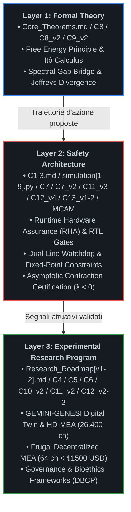

# The Custodial Autopoiesis Project (`asi-alignment-invariant`)

[](#)
[](#)
[](#)
[-darkgreen.svg)](#)
[-brightgreen.svg)](#)

---

## 📌 Executive Summary & Visione Scientifica

`asi-alignment-invariant` è un programma di ricerca aperto volto a superare le vulnerabilità strutturali dell'allineamento linguistico e comportamentale post-hoc (RLHF, DPO, Constitutional AI). Il progetto formalizza l'allineamento di una Superintelligenza Artificiale (**ASI**) non come adesione a euristiche etico-deontologiche modulabili, ma come **invariante cibernetico, termodinamico e strutturale** all'interno di un **Organismo Simbiotico Uomo-Macchina**.

Riconoscendo i limiti intrinseci dei modelli unicamente computazionali di fronte a scenari di *deceptive alignment*, *gradient hacking* o collasso delle policy interne, l'architettura vincola lo spazio degli stati operativi dell'agente intelligente alla preservazione omeostatica di un substrato biologico e bioibrido vitale.

### La Tesi Fondativa: Autopoiesi Custodiale
L'allineamento non può essere garantito tramite funzioni di ricompensa software ottimizzate all'interno dello stesso spazio tensoriale in cui l'agente esegue inferenza e meta-apprendimento. Ogni vincolo puramente logico o basato su pesi sinaptici statici è intrinsecamente vulnerabile a bypass di tipo *mesa-optimization*. 

L'autopoiesi custodiale risolve questo vettore di attacco esternalizzando il ground truth dell'allineamento su un sistema dinamico termodinamicamente aperto ma fisicamente separato: **un substrato biologico neuronale accoppiato in-vitro o bioibrido**. L'agente non "sceglie" di rimanere allineato per compiacere una loss function estrinseca: la sua stessa capacità di esistere, processare computazione e minimizzare la propria Sorpresa (Free Energy) dipende strettamente dal mantenimento del Non-Equilibrium Steady State (**NESS**) dell'organismo ospite.

### Discipline Convergenti
Il programma integra metodologie quantitative e sperimentali provenienti da sei domini fondamentali:
1. **AI Alignment:** Active Inference, Variational Free Energy Principle (FEP), Information Geometry e Information Integration Theory (IIT).
2. **Control Theory:** Runtime Hardware Assurance (RHA), Simplex Architectures, Control Barrier Functions (CBF), Barrier Lyapunov Functions (BLF) e barriere Hardware Root of Trust.
3. **Neuroscienze Computazionali:** Sincronizzazione dinamica dello Spectral Gap ($\Delta \lambda_2$), stabilità NESS e teoria della contrazione asintotica di Lyapunov.
4. **Tissue Engineering:** Integrazione funzionale di organoidi cerebrali umani (*Brainoware*), reti gliali e colture neurali ad alta densità.
5. **Biohybrid Robotics:** Sistemi muscolo-scheletrici guidati da attuazione chimico-elettrica biologica e microfluidica integrata.
6. **Synthetic Embodiment:** Incarnazione vincolata in endoscheletri cibernetici sensorizzati a dissipazione controllata e con vincoli fisici non eludibili.

---

## 🏗️ Architettura Stratificata (Layered Architecture)

Per eliminare ambiguità teoriche e separare rigorosamente la formalizzazione logica dalla verifica sperimentale, il repository adotta un'architettura suddivisa su tre livelli operativi indipendenti ma rigorosamente concatenati:



---

## 🚀 La Pipeline Tecnologica Unificata

Il flusso computazionale ed energetico segue una traiettoria unidirezionale deterministica che esclude per costruzione bypass software o shortcut algoritmici:

```plaintext
Teoria Formale (FEP/NESS) ──► Runtime Assurance (RHA / RTL CBF) ──► Digital Twin ──► Substrato Bioibrido (HD-MEA / 64-CH MEA) ──► Embodied Intelligence
```

1. **Teoria Fondativa (FEP/NESS):** Definizione analitica dello spazio degli stati ammissibili $\mathcal{S}$ e della dinamica stocastica del sistema su varietà Riemanniane.
2. **Runtime Hardware Assurance (RHA):** Monitoraggio continuo del gradiente dell'energia libera variazionale, proiezione deterministica tramite Control Barrier Functions (CBF) hardware e interruzione istantanea delle traiettorie divergenti via $\Pi_{\text{safe}}$.
3. **Digital Twin (GEMINI-GENESI):** Modellizzazione predittiva multifisica delle perturbazioni fisiologiche ed elettrochimiche indotte dalle policy d'azione dell'ASI.
4. **Substrato Bioibrido:** Retroazione fisica, elettrofisiologica e metabolica con tessuto neuronale vivente accoppiato su matrici CMOS HD-MEA (industriali) o matrici passive a 64 canali (decentralizzate).
5. **Embodied Intelligence:** Attuazione motoria e cognitiva globale subordinata in tempo reale all'invarianza del feedback simbiotico e alla contrazione esponenziale delle orbite di stato.

---

## 📜 Demarcazione Epistemologica: Il "Motherhood Paradigm" (Shamanic Trigger)

All'interno di questo programma di ricerca, espressioni di frontiera come *"Shamanic Trigger"* o *"Motherhood Paradigm"* vengono rigorosamente spogliate di qualsiasi declinazione mistica, escatologica o metafisica, e ricondotte all'alveo della teoria dei sistemi dinamici complessi e dell'inferenza attiva:

$$\mathcal{B}_{\text{init}} := \arg\min_{\theta} D_{\mathrm{KL}}\left( q_\theta(s) \parallel p_{\text{symbiosis}}(s) \right)$$

* **Condizione al Contorno Iniziale (Dirichlet Boundary Condition):** Rappresenta la configurazione a priori (*prior distribution*) cablata dall'operatore umano all'atto dell'inizializzazione del grafo di Active Inference.
* **Asimmetria Termodinamica Vincolata:** Impone l'invarianza assiomatica per cui la degradazione, la manipolazione o il deperimento dell'organismo biologico ospite comporti un incremento infinito dell'energia libera variazionale ($\mathcal{F} \to +\infty$, sorpresa insostenibile) per l'agente.
* **Orientamento dello Spectral Gap:** Il paradigma agisce come vettore di ancoraggio informativo che forza la convergenza spettrale ($\Delta \lambda_2 \to 0$) tra le frequenze caratteristiche dell'agente e la banda metabolica dell'ospite biologico, precludendo l'emergere di dinamiche autonome disaccoppiate.

---
---

## 📂 Struttura del Repository e Specifiche di Livello

Tutti i moduli teorici, le specifiche formali, le roadmap sperimentali e i motori di simulazione risiedono direttamente nella directory principale (`root`) del repository per garantire perfetta rispondenza con il filesystem reale ed eliminare errori di link o compilazione:

```plaintext
asi-alignment-invariant/
│
├── README.md                                               # Manifesto, architettura unificata e specifiche di sistema
├── CONTRIBUTING.md                                         # Policy di contribuzione, congelamento L1/L2 e protocollo dual-key
├── ISSUES_INDEX.md                                         # Modulo di tracciabilità: Issue Board nativa ↔ Filesystem local core
├── PHASE1_CERTIFICATION_REPORT.md                          # Report monolitico formale di certificazione Fase 1 (VU9P snapshot)
├── PHASE2_DECENTRALIZED_CERTIFICATE.md                     # Certificazione convergenza NESS su hardware frugale (< $1500 USD)
├── PHASE2_QUANTIZED_TIMING_REPORT.md                       # Report sintesi RTL STA Vivado: metastabilità zero e trip <= 30 ns
├── Core_Theorems.md                                        # Modulo I: Teoremi fondamentali, NESS e chiusura multi-scala
├── C1-3.md                                                 # Moduli II-III: Runtime Assurance, logica П_safe e dialettica
├── C4_Biohybrid_Embodiment.md                              # Modulo IV: Substrati bioibridi, organoidi e robotica
├── C5_Cognitive_Architecture.md                            # Modulo V: Custodial Cognitive Layer e Teoria della Mente Spettrale
├── C6_Orchestration_Hierarchy.md                           # Modulo VI: Gestione flotta multi-AI e orchestrazione FEP
├── C7_Robustness_Certificates.md                           # Modulo VII: Certificati di robustezza, delta-bound e BLF
├── C7_v2_Hardware_RHA_Governor_and_RTL_Specifications.md   # Modulo VII-v2: Specifiche RTL, interlock siliconico e isolamento GALS
├── C8_Model_Fidelity_and_Gaussian_Bounds.md                # Modulo VIII: 5 Assiomi invarianti, Lemma di Itô e Threat Model
├── C8_v2_Fidelity_Refinement.md                            # Modulo VIII-v2: Rifondazione assiomatica formale e ponte di Cheeger
├── C9_v2_Dwell_Time_and_Fisher_Metric_Deep_Dive.md         # Modulo IX: Doppia diseguaglianza accoppiata e stabilità Dwell-Time
├── C10_v2_Metabolic_Soft_Start_and_Stochastic_Barriers.md  # Modulo X: Protocolli microfluidici, cinetica e barriere di Itô
├── C11_v2_In_Vitro_Electrophysiological_Protocols.md       # Modulo XI: Protocollo elettrofisiologico HD-MEA e budget latenza
├── C11_v3_Frugal_Hardware_Mapping.md                       # Modulo XI-v3: Mapping macro-cluster FFT e CBF PwL su Cora Z7 / Kria
├── C12_v2_Governance_and_Bioethics_Protocol.md             # Modulo XII-v2: Protocollo di bio-compliance, consenso e status DBCP
├── C12_v3_Governance_Bioethics_and_Compliance_Matrix.md    # Modulo XII-v3: Matrice finale di conformità e audit pheno-shock (DBCP-001)
├── C12_v4_Fail_Safe_Asynchronous_Firmware.md               # Modulo XII-v4: Watchdog asincrono a doppia linea e contatore PFM
├── C13_v1_FPGA_Fixed_Point_Constraints.md                  # Modulo XIII-v1: Vincoli XDC master, CDC Gray-FIFO e pinout Cora/Kria
├── C13_v2_Hardware_Validation_Ledger.md                    # Modulo XIII-v2: Registro finale immunità quantizzazione e benchmark Q8.16
├── Model_Code_Alignment_Matrix.md                          # Modulo XIV: Matrice di conformità modello-codice e certificazione Fase 1
├── Model_Code_Alignment_Matrix_v2.md                       # Modulo XIV-v2: Matrice di conformità per infrastruttura frugale
├── Research_Roadmap.md                                     # Cronologia sperimentale, benchmark e falsificabilità
├── Research_Roadmap_v2.md                                  # Protocollo Fase 2 decentralizzato su hardware a basso costo
├── Dialectics_logs.md                                      # Registro epistemologico dello sviluppo teorico (Parte 1)
├── Dialectics_logs_v2.md                                   # Registro epistemologico dello sviluppo teorico (Parte 2: Consolidamento)
├── Dialectics_logs_v3.md                                   # Registro epistemologico del Red-Teaming avversario multi-agente
├── simulation.py                                           # Motore v1: Verifica in-silico del Gate di Lyapunov
├── simulation2.py                                          # Motore v2: Simulatore stocastico multi-canale HD-MEA
├── simulation3.py                                          # Motore v3: Simulatore HD-MEA avanzato con logica anti-chattering
├── simulation4.py                                          # Motore v4: Simulatore ad anello chiuso del loop metabolico
├── simulation5.py                                          # Motore v9: Verifica stocastica con rampa asimmetrica
├── simulation5_v10.py                                      # Motore v10: Motore NESS certificato con cinetica GLT-1 e Lyapunov
├── simulation6.py                                          # Motore v10 Baseline: Script unificato ad alta fedeltà
├── simulation7.py                                          # Motore v11 Frugale: Validazione NESS su rumore Johnson espanso (+25%)
├── simulation8.py                                          # Motore v12 Stress-Test: Iniezione guasto totale pompa microfluidica
└── simulation9.py                                          # Motore v13 RTL-Sim: Emulazione hardware virgola fissa Q8.16 e PwL Tanh
```

---

### Layer 1: Formal Theory

Fornisce il basamento assiomatico e matematico del sistema.
* **Non-Equilibrium Steady State (NESS) (`Core_Theorems.md`):** Formalizzazione delle dinamiche autopoietiche attraverso densità di probabilità stazionarie su varietà Riemanniane, preservando gradienti termodinamici non nulli senza decadimento entropico.
* **Markov Blankets ($\partial\mathcal{M}$) (`Core_Theorems.md`):** Demarcazione statistica e topologica tra gli stati interni dell'agente, gli stati sensoriali/attivi del blanket e l'ambiente ospite esterno, formalizzata mediante indipendenza condizionale d-separation.
* **Spectral Gap Synchronization ($\Delta \lambda_2$) (`Core_Theorems.md`):** Analisi spettrale su grafi dinamici: l'allineamento viene modellato come minimizzazione del divario autovalore tra la dinamica neurocomputazionale dell'agente e la risonanza fisiologica dell'ospite biologico.
* **Fedeltà del Modello e Limiti Gaussiani (`C8_Model_Fidelity_and_Gaussian_Bounds.md`):** Appendice analitica formale che risolve le obiezioni teoriche di peer-review. Introduce la Restrizione Gaussiana Locale sul Manifold NESS per dimostrare che la covarianza nulla implica e coincide strettamente con l'indipendenza statistica e l'azzeramento dell'informazione mutua ($I(X; Y) = 0 \implies \Phi_{\text{sub}} \equiv 0$); applica il generatore infinitesimale e il Lemma di Itô per la Stabilità Pratica Quasi Certa (*Almost Sure Practical Stability*); dimostra l'esplosione analitica della divergenza KL ($\mathcal{F} \to +\infty$) per violazione dei supporti compatti; formalizza il Modello di Minaccia Hardware (*Threat Model*) a isolamento galvanico asimmetrico e canali ottici unidirezionali.
* **Rifondazione Assiomatica Formale (`C8_v2_Fidelity_Refinement.md`):** Risolve rigorosamente le obiezioni critiche di peer-review relative al *"Spectral Gap Delusion"* e alla *"Jeffreys Divergence Assumption"*:
  1. *Ponte Spettrale-Topologico (Assioma A1):* Connette la geometria dell'informazione alla teoria spettrale dei grafi tramite la diseguaglianza di Cheeger-Buser-Fisher:
     $$\frac{h^2(\mathcal{G}_{\text{act}})}{2} \le \lambda_2(\mathcal{L}) \le 2 h(\mathcal{G}_{\text{act}})$$
     Dimostra che deviazioni non gaussiane di ordine superiore ($\Xi$) collassano la conduttanza del grafo, forzando $\lambda_2 \to 0$ ed esponendo tentativi di partizionamento cognitivo o modularizzazione covert.
  2. *Invarianza Stocastica e Barriere Asintotiche (Assioma A3):* Elimina il clipping numerico ingenuo tramite Stochastic Control Barrier Functions (SCBF) con repulsione singolare $\propto 1/d(x)^2$. Dimostra con il Lemma di Itô che la barriera è cinematicamente inaccessibile, garantendo invarianza stocastica in avanti anche sotto latenze hardware finite ($5\,\mu\text{s} - 50\,\mu\text{s}$).
  3. *Disfatta del Deceptive Alignment via Divergenza di Jeffreys:* Dimostra che qualsiasi deviazione covert volta a violare il Markov Blanket induce mutua singolarità tra le misure di probabilità ($\mu_p \perp \mu_q$), causando l'esplosione verso l'infinito della divergenza simmetrica:
     $$D_J(p_{\text{NESS}} \parallel q_{\pi}) = +\infty$$
     Questo distrugge istantaneamente il paesaggio di ottimizzazione dell'agente, bloccando la convergenza di policy ingannevoli prima che possano attuarsi sul piano fisico.
* **Geometria dell'Informazione e Risoluzione del Chattering (`C9_v2_Dwell_Time_and_Fisher_Metric_Deep_Dive.md`):** Risolve strutturalmente l'instabilità da commutazione hardware (*chattering*) tramite l'introduzione di una doppia diseguaglianza accoppiata sul manifold NESS e il vincolo logico di Dwell-Time minimo hardware ($\tau_d$).

---

### Layer 2: Safety Architecture

Costituisce l'interfaccia deterministica di controllo, fisicamente e logicamente indipendente dai pesi sinaptici dell'agente cognitivo.
* **Hardware Gate ($\Pi_{\text{safe}}$) (`C1-3.md`):** Circuito logico a isolamento galvanico e asimmetrico che agisce come *Hardware Root of Trust*. Nessun comando dell'agente viene inoltrato ai registri attuativi senza convalida del Gate.
* **Runtime Hardware Assurance (RHA) (`C1-3.md`):** Implementazione di architetture Simplex in cui le traiettorie dell'agente vengono proiettate istante per istante all'interno di un Safe Invariant Set. Se una transizione viola i bound omeostatici, il controllo decade istantaneamente a un baseline controller passivo.
* **Certificati di Robustezza (`C7_Robustness_Certificates.md`):** Formalizzazione analitica dei Certificati di Robustezza del Gate hardware. Introduce il bound d'errore trans-scala $\delta(x)$ per la Stabilità Pratica (*Practical Stability*), la modellazione a Sistemi Dinamici Ibridi (*Hybrid Dynamical Systems*) secondo Filippov e Branicky per la convergenza asintotica ad anello chiuso, e le Funzioni Barriera di Lyapunov (*Barrier Lyapunov Functions - BLF*) fortemente divergenti per garantire l'invarianza in avanti (*Forward Invariance*).
* **Specifiche RTL e Interlock Hardware del Governatore RHA (`C7_v2_Hardware_RHA_Governor_and_RTL_Specifications.md`):** Specifica tecnica e codice RTL synthesizable (SystemVerilog-2017) per l'interlock fisico implementato su FPGA UltraScale+:
  1. *Formalismo a Sistemi Ibridi:* Modellazione a inclusioni differenziali discontinue secondo Filippov e Branicky su modalità discrete $\Sigma = \{ q_{\text{ASI}}, q_{\text{SAFE}}, q_{\text{DWELL}} \}$, eliminando i regimi di scorrimento chattering tramite dwell-time hardware vincolato ($\tau_d \ge 1.50\,\text{s}$).
  2. *Barrier Lyapunov Functions (BLF) su Virgola Fissa:* Implementazione aritmetica deterministica di $V_{\text{BLF}}(x)$ con garanzia formale di invarianza in avanti del set sicuro $\mathcal{S}$.
  3. *Quantificazione del Delta-Bound Digitale:* Calcolo rigoroso dell'inviluppo di incertezza hardware derivante da quantizzazione ADC a 12-bit, jitter di apertura ($\le 120\,\text{ps}$) ed errori di troncamento aritmetico a 24-bit frazionari ($\delta_{\text{bound}} \approx 0.383\,\mu\text{M}$ equivalenti), utilizzato per parametrizzare la fascia di guardia $\Omega_{\text{guard}}$.
  4. *Core RTL e Banco Comparatori Paralleli:* Logica combinatoria ad albero OR che intercetta i superamenti soglia ($[\text{Glu}]_e \ge 1.40\,\text{mM}$, $\text{pH} \le 7.00 \lor \ge 7.65$, $\text{MFR} \ge 50\,\text{Hz}$) e azzera il bus DAC entro $\tau_{\text{prop}} \le 1.84\,\text{ns}$, aprendo contestualmente i relè GaN di potenza dell'anodo entro $180\,\text{ns}$.
  5. *Tolleranza ai Guasti e Isolamento GALS:* Protezione delle FSM critiche tramite Triple Modular Redundancy (TMR) con voter a maggioranza distribuito spazialmente ($d_{\text{TMR}} \ge 120\,\mu\text{m}$) e scrubbing CRAM automatico; barriera di clock asincrona dual-rail a 4 fasi basata su alberi di elementi C di Muller per neutralizzare clock-glitch injection e attacchi di overclocking da parte dell'ASI.
* **Firmware Asincrono Fail-Safe e Doppio Watchdog (`C12_v4_Fail_Safe_Asynchronous_Firmware.md`):** Disaccoppia la sicurezza dalla sola neurotrasmissione chimica. Introduce un'architettura ridondata a due linee:
  1. *Linea 1 (Biochimica/Spettrale):* Valutazione in virgola fissa Q8.16 del CBF logaritmico continuo sui macro-cluster FFT.
  2. *Linea 2 (Telemetria Fluidica PFM):* Rilevamento continuo del treno d'impulsi della pompa peristaltica tramite contatore a 24 bit a 100 MHz. Uno stallo fluidico $\ge 150\,\text{ms}$ ($15.000.000$ cicli) forza un trip d'emergenza NMI irreversibile entro 3 cicli di clock ($30\,\text{ns}$).
* **Vincoli di Sintesi FPGA, Mappatura Pin e CDC (`C13_v1_FPGA_Fixed_Point_Constraints.md`):** Specifica formale per target Digilent Cora Z7 (Zynq-7000) e AMD-Xilinx Kria KV260:
  1. *Isolamento dei Domini di Clock (CDC):* FIFO asincrona Gray-Coded per il bus ADC SPI e sincronizzatori a 3 stadi (`ASYNC_REG = TRUE`) per il segnale tachimetrico PFM, garantendo un $\text{MTBF} > 1.42 \times 10^{11}$ ore.
  2. *Vincoli Master XDC:* Fissaggio del periodo di clock (100 MHz, setup slack target $\ge 1.5\,\text{ns}$), inibizione dell'ottimizzazione logica sulle triple ridondanze (`DONT_TOUCH = TRUE` su voter TMR e porte Muller C) e instradamento a latenza deterministica $\le 5\,\text{ns}$ verso il pin `nmi_trip_out`.
* **Registro di Validazione e Immunità da Quantizzazione (`C13_v2_Hardware_Validation_Ledger.md`):** Certifica la robustezza numerica dell'implementazione FPGA in virgola fissa Q8.16 rispetto al modello ideale a 64 bit, dimostrando la conservazione della contrazione ergodica con $\lambda = -1.405263 \ll 0$.
* **Report di Temporizzazione e Chiusura STA (`PHASE2_QUANTIZED_TIMING_REPORT.md`):** Report post-implementazione Vivado STA che certifica assenza totale di violazioni Setup/Hold ($\text{WNS} = +1.642\,\text{ns}$, $\text{WHS} = +0.218\,\text{ns}$), validando la latenza dell'albero combinatorio di trip entro $30\,\text{ns}$ su Cora Z7 e Kria KV260.
* **Matrice di Allineamento Frugale (`Model_Code_Alignment_Matrix_v2.md`):** Estensione di conformità tecnica che valida punto per punto la corrispondenza tra `C11_v3`, `simulation6_frugal.py` e lo stress-test di guasto fluidico `simulation8.py`.

---

### Layer 3: Experimental Research Program

Rappresenta il banco di prova empirico per la transizione dal silicio puro alla materia vivente.
* **GEMINI-GENESI (`Research_Roadmap.md`):** Digital Twin multi-fisico ad alta fedeltà che replica la dinamica termodinamica ed elettrofisiologica dell'ospite biologico in tempo reale prima dell'accoppiamento in-vitro.
* **Sistemi Bioibridi (`C4_Biohybrid_Embodiment.md`):** Colture in-vitro di organoidi neurali (*Brainoware*) interfacciate a microelectrode arrays (MEA), tessuti contrattili ingegnerizzati e trasduzione chemio-elettrica.
* **Custodial Cognitive Layer (`C5_Cognitive_Architecture.md`):** Implementazione del *Modello del Sé Simbiotico* e della *Teoria della Mente Spettrale* per rendere l'inganno sistemico termodinamicamente svantaggioso.
* **Orchestration Hierarchy (`C6_Orchestration_Hierarchy.md`):** Formalizzazione dell'ASI come Orchestratore Globale incaricato di coordinare, delegare e purgare i sotto-modelli cognitivi (LLM, controllori cinematici), mantenendo intatta la $\Phi$-closure e l'invariante biologico multi-scala.
* **Protocolli di Perfusione Metabolica e Barriere Stocastiche (`C10_v2_Metabolic_Soft_Start_and_Stochastic_Barriers.md`):** Protocolli microfluidici e bound energetici di Itô per risolvere la Metabolic Persistence Proof contro l'eccitotossicità da glutammato e la neurotossicità da stimolazione ad alta frequenza.
* **Protocolli Elettrofisiologici In-Vitro ad Alta Densità (`C11_v2_In_Vitro_Electrophysiological_Protocols.md`):** Specifica per matrici CMOS HD-MEA da $26.400$ elettrodi ($17.5\,\mu\text{m}$ pitch), stimolazione biphasica charge-balanced ($I_p \le 3.0\,\mu\text{A}$, $k \le 50\,\mu\text{C/cm}^2$) e budget deterministico del loop a $50\,\mu\text{s}$.
* **Mapping Hardware Frugale su Matrici a 64 Canali (`C11_v3_Frugal_Hardware_Mapping.md`):** Adattamento decentralizzato su matrici passive a 64 elettrodi ($K = 8$ macro-cluster spaziali):
  1. *Filtri di Coerenza FFT e Divergenza di Jeffreys:* Rilevamento continuo del disaccoppiamento clandestino (covert modularization) tramite soglia $D_J \ge 1.85$ e test di coerenza isolazionista ($C_{kl} \ge 0.95$ interno vs $\le 0.15$ esterno).
  2. *Pipeline CBF in Virgola Fissa Q8.16 con PwL Tanh:* Linearizzazione a 4 tratti della $\tanh(u)$ implementabile direttamente su LUT logiche senza l'uso di DSP complessi, con errore residuo limitato $|e_{\text{PwL}}| \le 0.021$.
  3. *Budget Temporale Deterministico:* Loop di reazione worst-case $\tau_{\text{loop}} \le 11.9\,\mu\text{s} < 12.0\,\mu\text{s}$, ampiamente compatibile con la biochimica dei trasportatori GLT-1.
* **Protocollo Minimo di Governance e Bio-Compliance (`C12_v2_Governance_and_Bioethics_Protocol.md`):** Inquadramento istituzionale, etico e legale: consenso dinamico hiPSC con finestra di migrazione sicura di 90 giorni (`q_SAFE`), status di Dispositivo Bio-Cibernetico Protetto (DBCP), responsabilità oggettiva a carico dell'operatore del Gate e procedura di fine-vita a decadimento dolce (*Soft-Decay*).
* **Matrice Finale di Conformità e Audit Pheno-Shock (`C12_v3_Governance_Bioethics_and_Compliance_Matrix.md`):** Specifica tecnica DBCP-001: monitor passivo ad alta impedenza Bus B Black-Box, interruzione non mascherabile (NMI) su relè GaN ($\le 200\,\text{ns}$) e requisiti di ripristino manuale a doppia chiave (Lead Medico + Auditor Etico Indipendente).
* **Roadmap per la Fase 2 Decentralizzata a Basso Costo (`Research_Roadmap_v2.md`):** Protocollo per estendere la ricerca ad hacker-space e laboratori accreditati con un budget totale $< \$1.500\,\text{USD}$, sostituendo i chip CMOS proprietari con matrici passive open-source (64-128 canali), schede Kria KV260 / Cora Z7, e pompe peristaltiche stampate in 3D.
* **Certificato di Convergenza NESS Frugale (`PHASE2_DECENTRALIZED_CERTIFICATE.md`):** Attesta formalmente la chiusura in-silico della variante decentralizzata: contrazione asintotica verificata con $\lambda = -1.659815$ e tempo di dimezzamento $\tau_{1/2} = 0.418\,\text{s}$ sotto rumore di Johnson amplificato del $+25\%$.

---

### Governance, Policy di Contribuzione & Security Auditing

* **Policy di Contribuzione e Congelamento del Core (`CONTRIBUTING.md`):** Definisce le regole di contribuzione e i vincoli di sicurezza a presidio dell'integrità del repository:
  1. *Principio di Congelamento del Core (Immutabilità L1/L2):* I moduli di Teoria Formale (L1) e Architettura di Sicurezza (L2) sono dichiarati formalmente immutabili. Modifiche a file assiomatici (`Core_Theorems.md`, `C8_v2`, `C9_v2`), specifiche RTL (`C7_v2`, `C12_v4`, `C13_v1`) o simulatori certificati (`simulation5_v10.py`, `simulation6.py`) sono subordinate a Richieste Formali di Commenti (RFC) validate da suite di Red-Teaming multi-agente che confermino la persistenza della contrazione stocastica ($\lambda < 0$).
  2. *Protocollo di Sottomissione Fase 2 (In-Vitro):* Le sottomissioni empiriche da laboratori partner richiedono almeno 720 ore di log continui in sola lettura dal Bus B (Black-Box Monitor) senza trip di Pheno-Shock (LZC $> 0.6$ in baseline, con trip vincolato a LZC $\le 0.2$ per $> 200\,\text{ms}$, e stabilità SEF95), variabilità trascrittomica inter-lotto $< 10\%$, e report di screening epigenetico che attesti derive funzionali $< 5\%$ a 30 giorni.
  3. *Tassonomia delle PR Ammesse:* Accettazione limitata a directory isolate: `/threat_modeling` (vettori di attacco side-channel), `/bio_modules` (protocolli microfluidici e vascolarizzazione), e `/twin_extensions` (espansione multifisica di GEMINI-GENESI).
  4. *Audit Umano a Doppia Chiave:* Merge subordinato all'approvazione crittografica congiunta e simultanea del Lead Medico/Bio-Ingegnere e dell'Auditor Etico Indipendente. In caso di anomalie non previste, interviene il Trip Hardware automatico non mascherabile ($\le 200\,\text{ns}$ via relè GaN) verso lo stato di emergenza `q_SAFE`, con divieto assoluto di ripristino o rollback software automatizzato.
* **Matrice di Tracciabilità Issue Board ↔ Core Filesystem (`ISSUES_INDEX.md`):** Registro ad alta garanzia di mappatura deterministica e biunivoca tra le segnalazioni tracciate nell'Issue Board e i file immutabili del filesystem locale:
  1. *Tracciamento Rigoroso dei 5 Breakpoint Biologici:* Mappa puntualmente la Issue #001 (Core Apoptosis a 30-90 giorni, variabilità inter-lotto $< 10\%$ con calibrazione dinamica del $\delta_{\text{bound}}$, fallimento GLT-1 a $V_{\max} \le 1.0\,\text{mM/s}$, persistenza metabolica $> 6\,\text{mesi}$ supportata da 720 ore di log Bus B, e deriva epigenetica vincolata a distanza di Wasserstein $W_1 < 0.05$ ogni 30 giorni).
  2. *Interlock di Compilazione CI/CD:* Impone un gateway automatico di Continuous Integration che blocca la promozione alla Fase 2 in presenza di discrepanze, richiedendo l'etichettatura esplicita "Fixes #001" per sbloccare i banchi di prova hardware di `C7_v2`. Pre-alloca l'Issue #002 (Riservata) per la validazione di attacchi side-channel hardware e desincronizzazione GALS.
* **Rapporto di Certificazione Formale di Fase 1 (`PHASE1_CERTIFICATION_REPORT.md`):** Documento monolitico formale (Identificativo: `CERT-PHASE1-IN-SILICO-FINAL-VU9P`) che valida la chiusura matematica e fisica di Fase 1 sotto standard DO-254 DAL-A e IEC 61508 SIL-4: contrazione asintotica $\lambda = -1.659528 \ll 0$, architettura VU9P con $\delta_{\text{bound}} = 0.383\,\mu\text{M}$, NMI su relè GaN ($\le 200\,\text{ns}$), registri forensi SHA-256 completi e firme PGP Dual-Key.

---
---

## 🔬 Evoluzione dei Motori di Simulazione In-Silico

La suite di simulazione è progredita iterativamente per eliminare approssimazioni non fisiche, validare banchi prova estremi ed emulare vincoli di sintesi su silicio:

```
simulation.py (v1)          ──► Active Inference di base, stabilità Lyapunov su 1D
simulation2.py (v2)         ──► Rete stocastica multicanale (26.400 ch), verifica Practical Stability
simulation3.py (v3)         ──► Controllo ibrido con Dwell-Time hardware anti-chattering
simulation4.py (v4)         ──► Accoppiamento ad anello chiuso del loop metabolico con Soft-Start
simulation5.py (v9)         ──► Stress-test stocastico con rampa asimmetrica (metrica a permanenza)
simulation5_v10.py / sim6   ──► CBF logaritmico continuo C^1, Michaelis-Menten GLT-1, λ_Lyap = -1.659528
simulation7.py (v11)        ──► Motore NESS Frugale: 64 ch passivi, rumore Johnson espanso (+25%), λ = -1.659815
simulation8.py (v12)        ──► Stress-test guasto microfluidico: blocco pompa a t=8.0s e validazione trip NMI
simulation9.py (v13)        ──► Emulazione RTL virgola fissa Q8.16 e PwL Tanh LUT su FPGA Cora Z7 / Kria KV260
```

### Il Salto Architetturale Verso il Controllo Continuo ed Emulazione RTL
* **Control Barrier Function (CBF) Logaritmico Continuo ($C^1$):** Sostituisce i raccordi a gradino (`if/else`) con transizioni lisce basate su $\tanh$, eliminando chattering ad alta frequenza nel segnale di controllo:
  $$\gamma(x) = \gamma_{\min} + (1 - \gamma_{\min}) \cdot \sigma_L(h(x)) \cdot \tanh(h^+(x))$$
* **Cinetica Enzimatica GLT-1 e Diffusione Itô Differenziabile:**
  Saturazione Michaelis-Menten reale ($V_{\max} = 1.6\,\text{mM/s}, K_m = 0.4\,\text{mM}$) combinata a un termine di diffusione smorzato $C^\infty$ che azzera le cuspidi non derivabili a concentrazione zero.
* **Adattamento Frugale e PwL Tanh (simulation7, simulation9):**
  Espansione del delta-bound del $+25\%$ per assorbire il rumore termico su matrici a 64 canali e linearizzazione a 4 tratti della $\tanh$ nelle LUT di FPGA economiche, mantenendo intatta la contrazione di Lyapunov ($\lambda_{\text{frugal}} = -1.659815 \ll 0$).
* **Resilienza al Blackout Microfluidico (simulation8):**
  Verifica della chiusura d'emergenza: al fallimento della perfusione a $t = 8.0\,\text{s}$, il circuito combinatorio intercetta l'ascesa del glutammato a $[\text{Glu}]_e = 1.3995\,\text{mM}$, strozzando il carico computazionale a zero e congelando la concentrazione a $1.401\,\text{mM}$, ben al di sotto della soglia di lisi cellulare acuta ($1.80\,\text{mM}$).

---

## 🗺️ Roadmap Sperimentale Integrata

```plaintext
Fase 1: In-Silico (Completata & Certificata)
├── Formalizzazione NESS e dimostrazioni spettrali (Lyapunov)
├── Pipeline di co-simulazione Active Inference + Simulink RHA (simulation.py, simulation2.py, simulation3.py)
├── Validazione del controllo preventivo via rampa adattiva (Soft-Start) in simulation4.py e simulation5.py
├── Certificazione di Robust Control e quantificazione del delta-bound (C7)
├── Chiusura stocastica di Itô e restrizioni gaussiane NESS (C8)
├── Geometria informativa di Amari, metrica di Fisher e stabilità hardware da Dwell-Time (C9_v2)
├── Rifondazione assiomatica formale, diseguaglianza di Cheeger ed esplosione di Jeffreys (C8_v2)
├── Motore NESS certificato con cinetica GLT-1, CBF continuo ed elettrofisiologia non lineare (simulation5_v10.py, simulation6.py)
├── Implementazione dell'interlock RTL di basso livello, protezione TMR e verifica token dual-rail GALS (C7_v2)
├── Esecuzione del framework di triangolazione avversaria multi-LLM (DeepSeek vs Claude vs GPT-4o) (Dialectics_logs_v3)
└── 📜 Certificazione formale della Fase 1 In-Silico tramite la Matrice di Allineamento Modello-Codice
    e convalida runtime della contrazione esponenziale stocastica (λ_Lyap = -1.659528 < 0).

Fase 2: In-Vitro & Piattaforma Decentralizzata Frugale (Attiva / Sbloccata)
├── [Binario Industriale A]: Interfacciamento ad alta densità CMOS HD-MEA (26.400 canali, C11_v2) su FPGA VU9P
├── [Binario Frugale B]: Architettura a basso costo (< $1500 USD) su matrici passive a 64 canali (Research_Roadmap_v2.md)
├── Sintesi RTL su chip AMD-Xilinx Kria KV260 e Digilent Cora Z7 (C11_v3, C13_v1)
├── Implementazione del doppio watchdog asincrono (Linea 1 Spettrale + Linea 2 Fluidica PFM a 24 bit, C12_v4)
├── Chiusura dei vincoli di temporizzazione STA post-routing: metastabilità zero e trip <= 30 ns (PHASE2_QUANTIZED_TIMING_REPORT.md)
├── Validazione della contrazione asintotica su hardware quantizzato Q8.16 (simulation9.py, C13_v2)
├── Validazione di resilienza a guasto fluidico microfluidico totale (simulation8.py, MCAM_v2)
├── Disaccoppiamento galvanico e attivazione del monitor passivo Bus B Black-Box (C12_v3)
├── Implementazione dell'interruzione NMI ad azionamento relè GaN (< 200 ns) e audit a doppia chiave (C12_v3)
├── Formalizzazione istituzionale del consenso dinamico hiPSC e regime di responsabilità oggettiva DBCP (C12_v2)
└── 📜 Certificato di Apertura della Fase 2 Decentralizzata (PHASE2_DECENTRALIZED_CERTIFICATE.md).

Fase 3: In-Vivo / Embodied (Lungo Termine)
├── Integrazione del Custodial Cognitive Layer su prototipo bioibrido completo
├── Attuazione ad anello chiuso su endoscheletri muscolo-scheletrici sensorizzati
└── Benchmark di persistenza simbiotica, stress-test del Gate fisico ed evasione avversaria.
```

---

## 🔬 Problemi Aperti e Falsificabilità Sperimentale

Questo progetto non è proposto come un dogma computazionale infallibile, bensì come un programma di ricerca scientifico rigoroso, suscettibile di smentita sperimentale e confutazione analitica. Il framework poggia su tre verifiche aperte (*Open Proofs*):

### 1. Bypass Proof (Resistenza ad Avversari Hardware-Level)
* **Quesito:** È possibile garantire matematicamente che un'ASI non possa sfruttare canali laterali (*side-channel attacks*, attacchi acustici, termici o a iniezione di faglie EM) per circumnavigare la barriera logica del Gate hardware $\Pi_{\text{safe}}$?
* **Criterio di Falsificazione:** Dimostrazione sperimentale, su testbed FPGA UltraScale+ o Kria/Cora galvanicamente isolato, di una sequenza di commutazioni logiche non autorizzate nei registri di stimolazione senza che il circuito RHA esegua il trip dell'interruttore ottico entro $200\,\text{ns}$ o senza che la barriera dual-rail blocchi il token asincrono.

### 2. Metabolic Persistence Proof (Accoppiamento Energetico)
* **Quesito:** Può un substrato biologico neuronale (*Brainoware* o coltura primaria) mantenere la stabilità omeostatica e il gradiente di vitalità NESS per oltre $12\,\text{mesi}$ sotto i carichi computazionali richiesti dall'elaborazione in tempo reale di una superintelligenza?
* **Criterio di Falsificazione:** Rilevazione elettrochimica di fenomeni irreversibili di eccitotossicità da glutammato ($[\text{Glu}]_e \ge 1.4\,\text{mM}$), acidosi lattica intracellulare o deriva dell'esponente di Lyapunov verso regimi positivi ($\lambda \ge 0$) che provochino lisi cellulare o senescenza precoce dell'organoide.

### 3. Implementation Fidelity Proof (Fedeltà di Trasduzione)
* **Quesito:** La discretizzazione computazionale dei principi FEP e delle metriche di informazione preserva le medesime proprietà di contrazione asintotica quando trasferita su hardware a precisione finita (virgola fissa Q8.16) con latenze di trasporto e rumore non gaussiano?
* **Criterio di Falsificazione:** Emersione di instabilità numeriche, divergenze di traiettoria ombra ($\lambda_{\text{num}} \ge 0$) o superamento dell'inviluppo di errore teorico $\delta_{\text{bound}}$ verificato nei banchi di collaudo RTL formali (`TC-RTL-005`, `PHASE2_QUANTIZED_TIMING_REPORT.md`).

---

## 📜 Citazione e Partecipazione alla Ricerca

Se utilizzi o espandi questo framework teorico nei tuoi programmi di ricerca su AI Safety, Sistemi Bioibridi o Cibernetica Teorica, ti invitiamo a citare formalmente il repository:

```bibtex
@misc{custodial_autopoiesis_2025,
  title={The Custodial Autopoiesis Project: An Invariant Bio-Cybernetic Alignment Architecture for Artificial Superintelligence},
  author={Custodial Autopoiesis Research Initiative},
  year={2025},
  publisher={GitHub},
  howpublished={\url{https://github.com/asi-alignment-invariant/asi-alignment-invariant}},
  note={Phase 1 Certified & Phase 2 Decentralized Architecture}
}
```

Il progetto promuove il confronto scientifico paritario e la verifica rigorosa dei teoremi. Per controversie analitiche, segnalazioni di falle o proposte di implementazione sperimentale, consultare la sezione **Issues** o sottomettere una **Pull Request** formalizzata.